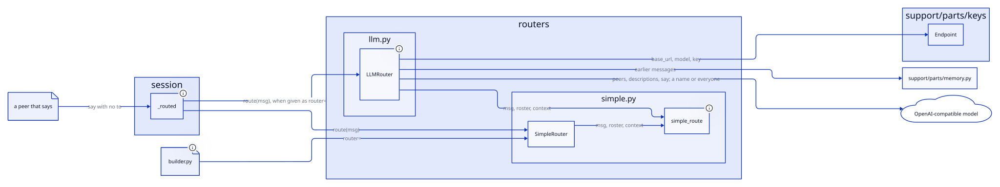

# Design: add-llm-router

## Context

See `proposal.md` for the motivation. The session awaits `router.route(msg)` before it posts a say
that names nobody, and keeps the route only when it is another peer that answers (REQ-ROUTE-001,
REQ-ROUTE-003). `SimpleRouter` (`routers/simple.py`) holds its two rules inside its own `route`. A
peer has a name and no description. `support/parts/keys` gives `Endpoint` (base_url, model, a key
source read late) and `read_async`; `support/parts/memory.py` gives `earlier()`, what a `Query`
selects without the message being answered. `routers/simple.py` is a core module in
`tests/test_architecture.py` and must import no library; `chatinho` must import with `openai`
blocked.

## Goals / Non-Goals

**Goals:**
- One place for `SimpleRouter`'s rules, used by both routers, so they cannot drift (REQ-ROUTE-007).
- A model call that never costs more than `timeout`, and never silences a say (REQ-ROUTE-009).
- `openai` imported only when `LLMRouter` is read (REQ-ROUTE-011).

**Non-Goals:**
- Several recipients, posting before routing, descriptions in `/help`, the `@` popup or MCP.
- Sharing a client with `OpenAIConnector`: the layer rule forbids `routers/` importing
  `connectors/`.

## Decisions

### SimpleRouter's rules become a function both routers call

`simple.py` gains `simple_route(msg, roster, context) -> Optional[int]`, the body of
`SimpleRouter.route` moved out unchanged, and `answering(msg, roster) -> List[int]`, the answering
peers that are neither the speaker nor `LOCAL`. `SimpleRouter.route` calls `simple_route`;
`LLMRouter.route` calls it first and asks the model only when it returns None and `answering` holds
two or more. Alternatives: `LLMRouter` subclassing `SimpleRouter` (the library keeps two base classes,
deliberately, and this is not a third); holding a `SimpleRouter` inside and copying the grants onto it
at each call (grants arrive by `setattr` after construction, so the copy would be a hidden second
door). `llm.py` importing `simple.py` stays inside one specialization. Serves: REQ-ROUTE-007.

### The router catches its own failures and returns None

A model error, a timeout, an unreadable key, an unknown or shared name: each is logged as a warning by
`LLMRouter` and answered with None, so the say is posted as a broadcast. Letting them raise would also
reach nobody (REQ-ROUTE-003) but logs an error with a traceback for what is an expected, recoverable
outcome, and could not say which of the five it was. The warning names the reason, the error's type
and the key's reference, never the say's text or a key. The whole choice runs under
`asyncio.wait_for(..., timeout)`. Serves: REQ-ROUTE-009.

### The model answers one word

The prompt is a system message saying what to do, listing each candidate as `- <name>: <description>`
(`- <name>` with none) and the word `everyone`, and asking for exactly one of them; then a user message
with the earlier messages as `<name>: <text>` lines (the frontend by its own name, a departed peer by
its number, a command's output as `tool`) and the say last. Temperature 0, `max_tokens` small (16).
The answer is normalised (strip whitespace and quotes, drop one leading `@` and trailing `.,!?:;`,
lower-case) and compared with each candidate's lower-cased name: exactly one match routes to it,
`everyone` is None, anything else is a warning and None. Alternatives: JSON or a tool call (more
robust parsing, but not every OpenAI-compatible server supports tools or JSON mode, Ollama's small
models among them). Serves: REQ-ROUTE-008, REQ-ROUTE-009.

### One kept client for its own key, one per say for a lent key

The own key is read with `read_async` on each choice (sources cache what is costly, REQ-KEYS-002); the
client is kept with a digest of the key and rebuilt when the key changes. A replaced client is kept
aside and closed at `shutdown` rather than at once, since another say may still be routing on it. A
lent key gets `async with AsyncOpenAI(...)` for that say alone, so nothing of it outlives the say.
`OpenAIConnector` counts requests per client to close a replaced one early; a router replaces its
client only when a key rotates, so closing at shutdown is enough. Serves: REQ-ROUTE-010.

### Lazy everywhere openai would otherwise be imported

`routers/llm.py` imports `openai` at its top. `routers/__init__.py` keeps importing `simple` eagerly and
resolves `LLMRouter` with a PEP 562 `__getattr__`; the package root lists `LLMRouter` in
`_BEHIND_AN_EXTRA` as `(".routers.llm", (("openai", "openai"),))`, with its import under
`TYPE_CHECKING` (the fitness test demands it) and in `__all__`. Serves: REQ-ROUTE-011.

### A description is set on the class, like a name

`connector(name, id=None, description="")` writes `cls.description`, so an instance overrides it by
setting `self.description`, exactly as `name`. A non-string is a `ValueError` at decoration time.
There is no `description_of()`: the router reads `getattr(peer, "description", "")`, since a peer
that is not a `@connector` (a frontend passed by hand, an undecorated class) has none. Serves:
REQ-CORE-002.

## Interfaces

Agreed with the user

- `src/chatinho/hooks.py`: `connector(name: str, id: Optional[int] = None, description: str = "")
  -> Callable[[type], type]`; sets `cls.description`; `ValueError` for a non-string description
  (REQ-CORE-002).
- `src/chatinho/routers/simple.py`:
  - `answering(msg: ChatMessage, roster: Dict[int, Any]) -> List[int]`: ids of the peers that answer,
    the speaker and `LOCAL` left out, in roster order (REQ-ROUTE-007);
  - `simple_route(msg: ChatMessage, roster: Dict[int, Any], context: Context) -> Optional[int]`:
    `SimpleRouter`'s two rules (REQ-ROUTE-004, REQ-ROUTE-005, REQ-ROUTE-007);
  - `SimpleRouter.route` unchanged in signature and behaviour.
- `src/chatinho/routers/llm.py`:
  - `ROUTING_MEMORY : Query = Query(errors=False).last(6)` (REQ-ROUTE-008);
  - `EVERYONE : str = "everyone"` (REQ-ROUTE-008);
  - `class LLMRouter`, `@require(HookRoute)`, `@require(HookPeers)`, `@require(HookContext)`,
    `name = "router"`, grants `peers : Peers`, `context : Context`;
  - `LLMRouter.__init__(self, endpoint: Optional[Endpoint] = None, *, memory: Optional[Query] =
    ROUTING_MEMORY, timeout: float = 10.0, credential: str = "llm") -> None`; the model is
    `endpoint.model or "gpt-4o-mini"`; a `timeout` that is not positive is a `ValueError`
    (REQ-ROUTE-008, REQ-ROUTE-009, REQ-ROUTE-010);
  - `async LLMRouter.route(self, msg: ChatMessage) -> Optional[int]` (REQ-ROUTE-007,
    REQ-ROUTE-008, REQ-ROUTE-009, REQ-ROUTE-010);
  - `async LLMRouter.shutdown(self) -> None`: closes every client it kept (REQ-ROUTE-010);
  - `AsyncOpenAI` is a module-level name, so tests replace it with `FakeOpenAI` from `tests/fakes/llm.py`.
- `src/chatinho/routers/__init__.py`: `__getattr__(name)` resolving `LLMRouter`; `__all__` gains it
  (REQ-ROUTE-011).
- `src/chatinho/__init__.py`: `LLMRouter` in `_BEHIND_AN_EXTRA`, under `TYPE_CHECKING`, and in
  `__all__` (REQ-ROUTE-011).

## Diagrams

The framework's structure does not change: `@connector` gains a keyword.

## Risks / Trade-offs

- [The user's say appears only after the model answers, when there is a choice] -> the model is asked
  only then (REQ-ROUTE-007), `timeout` caps the wait, and a small `max_tokens` keeps the answer short.
- [A model that answers a sentence instead of a word] -> it is a warning and a broadcast, never a
  wrong peer; the prompt asks for one word at temperature 0.
- [A peer's chatter routed to another peer] -> as today with `SimpleRouter`'s lone-peer rule; answers
  are addressed to nobody and never routed, so two peers cannot loop on answers.
- [The prompt holds earlier messages, sent to the model's provider] -> `memory=None` sends none; the
  default is small.
- [A new public name] -> `LLMRouter` makes `__init__.py` export 83 names; CLAUDE.md is updated at
  close.

## Migration / Rollback

None: opt-in through `router=`, and `description` defaults to empty.

## Open Questions

None.
