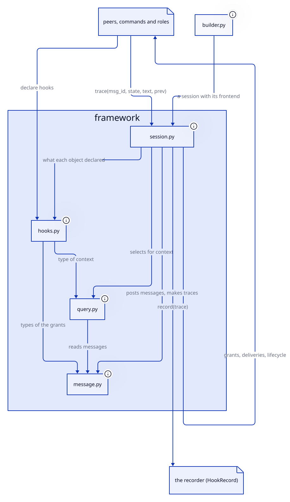
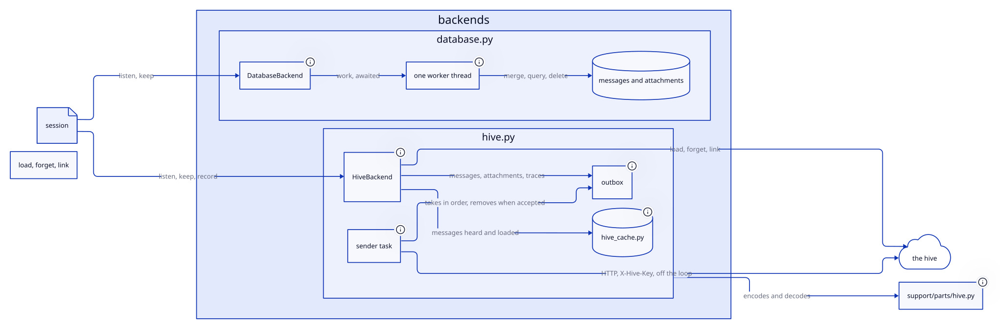
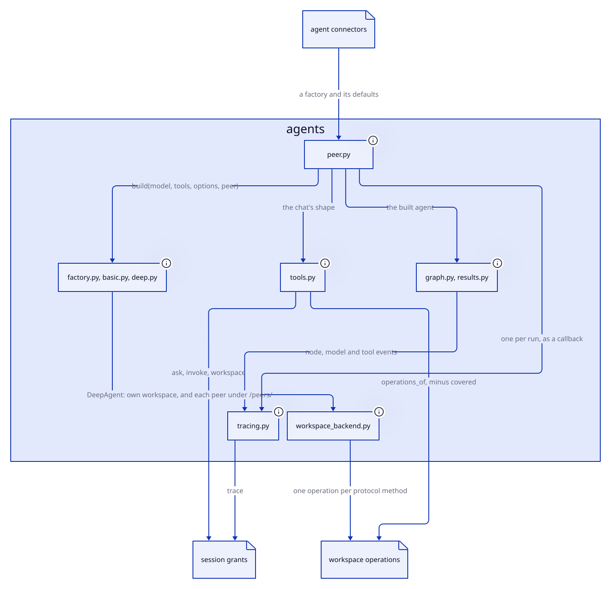
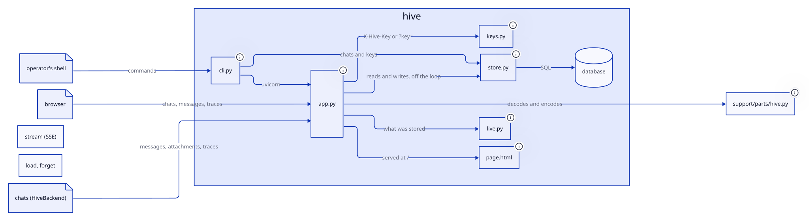

# Design: add-observer-server

## Context

See `proposal.md`. What shapes the approach:

- The session already hands something that is not a message to the backend:
  attachments go to the first `HookKeep` declarer before the message is posted
  (`_kept` in `session.py`). Traces take the same road to `HookRecord`.
- `tests/test_architecture.py` puts every top-level folder in a layer and keeps
  the parts stdlib-only. `hive/` becomes a specialization; what a chat and the
  hive both need to agree on goes in a part both import, as `mcp.py` does for
  the MCP frontend and connector.
- A message's `frm` is a per-session integer. The hive has to show who spoke,
  so the backend sends the speaker's name with each message and trace.
- `AgentPeer._run` calls `graph.ainvoke(..., config=config)`: LangChain
  callbacks in that config see every node, model call and tool call, with
  `run_id` and `parent_run_id`.

## Goals / Non-Goals

**Goals:**
- A trace is a framework record any peer may write and any backend may keep.
- A chat needs no extra to be kept in a hive; only the server does.
- Nothing about the hive can hold up a chat.

**Non-Goals:**
- Scaling the hive past one process, or replicating it.
- A general sync protocol between a cache and the hive.

## Decisions

### A trace is a record beside the message, made by the session

`ChatTrace` is a frozen dataclass in `message.py`, `TraceID` mirrors
`MessageID` (`trc-` + 16 hex) and `TraceState` is a `str` enum. The session
makes the id, stamps `frm` with the caller's id and the time, checks `prev`
against the set of ids it issued, cuts the text, and awaits the recorder like
`keep`. The alternative, traces as messages with a status, would have put them
in `context()`, every model's memory and the terminal log. Serves:
REQ-CORE-030, REQ-CORE-031, REQ-CORE-032.

### The wire format is a part

`support/parts/hive.py` holds the JSON a chat and the hive exchange, the paths
and the header name: `message_to_wire`/`message_from_wire`,
`trace_to_wire`/`trace_from_wire`. It is stdlib-only and imports only the
framework, so `backends/hive.py` and `hive/` agree without importing each
other. Each wire message and trace carries `frm_name` (from `peers()`, `tool`
for `TOOL`), which the framework records do not have. Timestamps are ISO 8601
strings. Serves: REQ-BACK-009, REQ-HIVE-004, REQ-HIVE-005.

### HiveBackend speaks HTTP with the standard library, off the loop

`urllib.request` on `asyncio.to_thread`, so a chat installs nothing and
nothing blocks; `httpx` would have meant an extra for every chat. Everything
written goes to an outbox; one sender task, started in `initialize`, takes it
in order: consecutive messages or traces in batches of up to 100, an
attachment alone. A failure that is not a refusal keeps the item and waits
0.5s, doubling to 30s; 401 or 403 drops what was being sent, counts it lost,
and logs one error naming the URL until a send succeeds again. `load`,
`forget` and `link` call the hive directly. Serves: REQ-BACK-009 to
REQ-BACK-012.

### The cache is a SQLite file holding a mirror and the outbox

`backends/hive_cache.py` (stdlib `sqlite3`, one connection guarded by a lock,
every call on a thread): tables `meta` (the hive URL), `messages` (id, time,
wire JSON), `attachments` (msg id, name, media type, bytes) and `outbox` (an
increasing sequence, the kind, the payload). With a cache, the outbox *is* the
table, so a restart resumes it; without one it is a `deque`. Both implement
one small `Outbox` interface the sender uses. Serves: REQ-BACK-011,
REQ-BACK-013.

### The hive is FastAPI over a synchronous SQLAlchemy store

`hive/store.py` is plain synchronous SQLAlchemy, as `DatabaseBackend` is;
`hive/app.py`'s routes are `async` and run store calls with
`starlette.concurrency.run_in_threadpool`, then publish what was stored to
`hive/live.py`, which keeps an `asyncio.Queue` per open stream. A resend is an
`INSERT` of a primary key that exists, skipped, and only rows really inserted
are published. Keys are `hive_` + 48 hex, stored as SHA-256 and found by hash;
a hash lookup needs no constant-time compare, since the hash is the index.
Serves: REQ-HIVE-001 to REQ-HIVE-007.

### The page is one static file with an SVG graph

`hive/page.html`: plain HTML, CSS and JavaScript, packaged as data. It asks
for the admin key once and keeps it in `localStorage`, lists the chats,
streams the chosen one with `EventSource(.../stream?key=...)`, and on a click
fetches the message's traces and draws them: a trace's column is its depth
along `prev`, its row its order among siblings, each an SVG box labelled with
`frm_name`, state and text, joined by a line to the trace it follows. No
library, so nothing comes from another host. Serves: REQ-HIVE-008.

### AgentPeer traces through a LangChain callback

`support/kits/agent/tracing.py` holds `RunTracer`, an
`AsyncCallbackHandler` made per run with the peer's `trace` grant and the
message id, and passed in the run's `config["callbacks"]`. It traces chains
whose `langgraph_node` metadata is one of the four node names at the top of
the run, every chat model call, and every tool call; a run it does not trace
is still remembered with its parent, so a traced step's parent is the nearest
traced ancestor. For each traced parent it keeps the last child that ended:
a new child follows that, or the parent's start when it is the first. Two tool
calls started before either ended follow the same trace. Text: the node name;
`model <name>`; `tool <name> <input>`; on the end the output, or the error's
type. Each tracer belongs to one run, so two questions never share state.
Serves: REQ-AGENT-012.

### Pinned wording

The tests assert these verbatim; the code writes them:

- The page marks what a browser test reaches with `data-testid`: `key` (the
  admin key input), `key-save` (its button), `chat` (each chat in the list),
  `message` (each message), `graph` (the trace graph), and `edge` (each line
  between two traces, with `data-from` and `data-to` holding the two trace
  ids). Each trace's box shows its text.
- `python -m chatinho.hive.cli` runs the same `main` as `chatinho-hive`.
- `HiveBackend`'s warnings name what happened with these words: `dropped`
  (the outbox was full, with how many), `lost` (left at shutdown with no
  cache, with how many), `kept` (left at shutdown in the cache, with how
  many), `cache` (history loaded from the cache). An unreachable hive or a
  refused key is logged with the hive's URL, never the key.
- A bad chat name is refused with a message containing `a-z`; a taken one
  with `taken`.

## Interfaces

Agreed with the user

- `src/chatinho/message.py`:
  - `TRACE_TEXT_LIMIT : int = 2000`
  - `class TraceState(str, Enum)`: `RUNNING = "running"`, `DONE = "done"`,
    `ERROR = "error"`
  - `@dataclass(frozen=True) class TraceID`: `hex: str`; `new()`,
    `parse(text) -> TraceID`, `__str__` gives `trc-<hex>`
  - `@dataclass(frozen=True) class ChatTrace`: `id: TraceID`,
    `msg_id: MessageID`, `state: TraceState`, `text: str`, `frm: int`,
    `prev: Optional[TraceID] = None`, `timestamp: datetime`
  (REQ-CORE-030)
- `src/chatinho/hooks.py`: `HookTrace = Hook(name="HookTrace",
  grants=("trace",))`, `HookRecord = Hook(name="HookRecord", method="record")`,
  both in `ALL_HOOKS`; `class Trace(Protocol)`: `async __call__(msg_id:
  MessageID, state: Union[TraceState, str], text: str, prev:
  Optional[TraceID] = None) -> TraceID` (REQ-CORE-030, REQ-CORE-033)
- `src/chatinho/session.py`: `ChatSession._trace(by: int, msg_id, state,
  text, prev=None) -> TraceID`, granted bound to the caller's id; raises
  `TypeError` for a `msg_id` that is not a `MessageID`, `ValueError` for an
  unknown state or `prev` (REQ-CORE-030 to REQ-CORE-032)
- `src/chatinho/__init__.py`: exports `ChatTrace`, `TraceID`, `TraceState`,
  `TRACE_TEXT_LIMIT`, `HookTrace`, `HookRecord`, `Trace`, `HiveBackend`,
  `HiveUnavailable` (92 names) (REQ-CORE-033)
- `src/chatinho/support/parts/hive.py`: `KEY_HEADER = "X-Hive-Key"`,
  `message_to_wire(msg: ChatMessage, frm_name: str) -> Dict[str, Any]`,
  `message_from_wire(data: Dict[str, Any]) -> ChatMessage`,
  `trace_to_wire(trace: ChatTrace, frm_name: str) -> Dict[str, Any]`,
  `trace_from_wire(data: Dict[str, Any]) -> ChatTrace`; a malformed payload
  raises `ValueError` (REQ-BACK-009, REQ-HIVE-004, REQ-HIVE-005)
- `src/chatinho/backends/hive.py`:
  - `class HiveUnavailable(ConnectionError)`
  - `@backend("hive") class HiveBackend`, declaring `HookListen`, `HookLoad`,
    `HookForget`, `HookKeep`, `HookLink`, `HookRecord`, `HookPeers`:
    `__init__(url: str, key: Union[str, KeySource], *, cache: Optional[str] =
    None, timeout: float = 10.0, queue_limit: int = 10000, flush_timeout: float
    = 3.0)`; `async initialize()`; `async shutdown()`; `async listen(msg)`;
    `async load(since=None, limit=None) -> List[ChatMessage]`; `async
    forget(before=None) -> int`; `async keep(msg_id, attachments)`; `async
    link(msg_id, name) -> Optional[str]`; `async record(trace)`
  (REQ-BACK-009 to REQ-BACK-013)
- `src/chatinho/backends/hive_cache.py`: `class HiveCache(path, url)` and the
  `Outbox` interface (`put`, `peek(n)`, `drop(n)`, `__len__`) with a memory
  and a cache implementation (REQ-BACK-011, REQ-BACK-013)
- `src/chatinho/support/kits/agent/tracing.py`: `class
  RunTracer(AsyncCallbackHandler)`: `__init__(trace: Trace, msg_id:
  MessageID)`; `AgentPeer` declares `HookTrace` and adds one to each run
  (REQ-AGENT-012)
- `src/chatinho/hive/__init__.py`: raises `ImportError` naming
  `chatinho[hive]` when `fastapi`, `uvicorn` or `sqlalchemy` is missing;
  exports `create_app` (REQ-HIVE-010)
- `src/chatinho/hive/app.py`: `create_app(db_url: str) -> FastAPI` with
  (REQ-HIVE-003 to REQ-HIVE-009):

  | method and path | key | body / query | answer |
  |---|---|---|---|
  | `POST /api/messages` | chat | `{"messages": [wire]}` | `{"stored": n}` |
  | `GET /api/messages` | chat | `since`, `limit` | `{"messages": [wire]}` |
  | `DELETE /api/messages` | chat | `before` | `{"forgotten": n}` |
  | `PUT /api/messages/{msg_id}/attachments/{name}` | chat | the bytes, `Content-Type` | 204 |
  | `GET /api/messages/{msg_id}/attachments/{name}` | chat | | the bytes, or 404 |
  | `POST /api/traces` | chat | `{"traces": [wire]}` | `{"stored": n}` |
  | `GET /api/chats` | admin | | `{"chats": [{"name", "messages", "last"}]}` |
  | `GET /api/chats/{name}/messages` | admin | `since`, `limit` | `{"messages": [wire]}` |
  | `GET /api/chats/{name}/messages/{msg_id}/traces` | admin | | `{"traces": [wire]}` |
  | `GET /api/chats/{name}/stream` | admin, or `?key=` | | SSE: `event: message` or `event: trace`, `data:` wire JSON |
  | `GET /` | none | | the page |
  | `GET /openapi.json`, `GET /docs` | none | | FastAPI's |

- `src/chatinho/hive/keys.py`: `make_key() -> str`, `hash_key(key: str) ->
  str`; `src/chatinho/hive/store.py`: `class Store(db_url)` with `add_chat`,
  `remove_chat`, `chats`, `add_admin`, `who(key_hash) -> Optional[Caller]`,
  `put_messages`, `messages`, `forget`, `put_attachment`, `attachment`,
  `put_traces`, `traces`; `src/chatinho/hive/live.py`: `class Live` with
  `subscribe(chat)`, `publish(chat, kind, wire)` (REQ-HIVE-001 to
  REQ-HIVE-007)
- `src/chatinho/hive/cli.py`: `main(argv=None) -> int`: `serve [--db]
  [--host 127.0.0.1] [--port 8700]`, `chat add <name>`, `chat list`, `chat
  remove <name>`, `admin add`, each with `--db` (default
  `sqlite:///hive.db`) (REQ-HIVE-001, REQ-HIVE-002, REQ-HIVE-010)
- `pyproject.toml`: extra `hive = ["fastapi>=0.110", "uvicorn>=0.29",
  "sqlalchemy>=2.0"]`, in `all` and `dev`; script `chatinho-hive =
  "chatinho.hive.cli:main"`; `page.html` in package data (REQ-HIVE-010)

## Diagrams

## Risks / Trade-offs

- [The session keeps every trace id it issued, so a long chat's set grows] ->
  a few tens of bytes per trace; bounded later if a chat ever traces millions.
- [`?key=` on the stream can land in an access log] -> only the stream takes
  it, the page is served from the hive itself, and the hive's own logging does
  not print query strings.
- [LangChain's callback events differ between versions] -> the tracer reads
  only `run_id`, `parent_run_id`, `name`, `metadata["langgraph_node"]` and the
  tool input and output, and its tests run a real graph with a scripted model.
- [SQLite under concurrent writes from the thread pool] -> one engine with
  `check_same_thread=False` and short transactions; one hive process.
- [The page's graph is drawn by hand] -> a layered layout on `prev` depth is
  enough for the dozens of steps a run makes; a browser test checks it draws.
- [The admin key lives in the browser's `localStorage`] -> it is the
  operator's own browser, and the page has a button that forgets it.

## Migration / Rollback

None: the hive is a new database, `DatabaseBackend` is untouched, and a chat
moves to the hive by changing its `backend=`. Removing the change removes the
extra and two hooks; no stored data needs converting.

## Open Questions

- The page's look beyond being readable on a phone is left to the code half.
