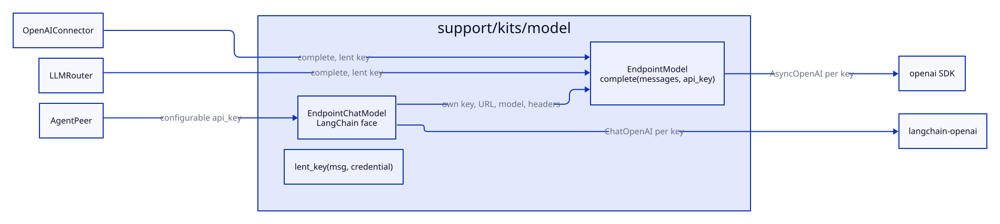

# Design: share-the-endpoint-model

## Context

Today three components turn an `Endpoint` into something that calls a model:
`OpenAIConnector` (an `AsyncOpenAI` per key, rotated out once idle),
`LLMRouter` (the same, with headers, rotated out at shutdown) and `AgentPeer`
(`EndpointChatModel` in `support/kits/agent/model.py`). The key a call needs
may come with the message (`msg.credentials`), so the call has to take it. See
proposal.md.

## Goals / Non-Goals

**Goals:**
- One model kit every component calls, taking the key per call (REQ-MODEL-001..004, 006).
- The OpenAI-only components keep needing `openai` alone (REQ-MODEL-005).

**Non-Goals:**
- A provider-neutral protocol beyond OpenAI-compatible endpoints.
- Sharing one `EndpointModel` between components.

## Decisions

### One model, two faces, in one kit

`support/kits/model/` holds `EndpointModel` (`endpoint.py`), over the `openai`
SDK, and its LangChain face `EndpointChatModel` (`chat.py`). `chat_model()`
imports `chat.py` on first use, so the kit needs LangChain only for agents.
Both resolve the key the same way — the call's, else the endpoint's own — and
`EndpointChatModel` asks its `EndpointModel` for the own-key function, the base
URL, the model name and the headers rather than reading the `Endpoint` again.
Serves REQ-MODEL-001, REQ-MODEL-003, REQ-MODEL-005.

Alternatives: LangChain everywhere (one face only) — `chatinho[openai]` would
need `langchain` and `langchain-openai`, heavy on Termux; offered to the person
with this one recommended. A stdlib protocol in `support/parts` with the
implementations in kits — a second name for one implementation, and the part
would have nothing to do.

### The connector's rotation rule for everyone

`EndpointModel` keeps the own client with a digest of its key and a count of
calls using each client; a client replaced by a rotated key is closed when its
count reaches zero (the connector's REQ-CONN-006 rule). The router's rule —
retired clients closed at shutdown — is the looser one and is dropped.
Serves REQ-MODEL-002.

### The key from the message is the caller's to read

`lent_key(msg, credential)` reads `msg.credentials`; each component calls it
with its own `credential` name and passes the result as `api_key`. The model
never sees the message, so it can be called by anything that has a key.
Serves REQ-MODEL-004.

### One door, checked

A test parses every module under `src/chatinho` and allows `AsyncOpenAI`,
`OpenAI` and `ChatOpenAI` to be imported only under `support/kits/model`.
Serves REQ-MODEL-006.

### Tests stub the client in one place

`fakes.llm.FakeOpenAI` is patched over `chatinho.support.kits.model.endpoint.AsyncOpenAI`,
which every OpenAI-only component now reaches.

## Interfaces

- `src/chatinho/support/kits/model/endpoint.py`:
  `EndpointModel(endpoint: Optional[Endpoint] = None, *, headers: Optional[Mapping[str, str]] = None)`
  with `name: str`, `base_url: Optional[str]`, `has_own_key: bool`,
  `await complete(messages: List[Dict[str, Any]], *, api_key: Optional[Secret] = None, **params) -> Any`
  (the SDK's completion), `chat_model() -> Any`, `await close() -> None` (REQ-MODEL-001, 002, 003);
  `lent_key(msg: ChatMessage, credential: str) -> Optional[Secret]` (REQ-MODEL-004).
- `src/chatinho/support/kits/model/chat.py`: `EndpointChatModel(model: EndpointModel)`, moved
  from `support/kits/agent/model.py`, same calls as before (REQ-MODEL-003).
- `src/chatinho/support/kits/model/__init__.py`: exports `EndpointModel`, `lent_key`; `EndpointChatModel` on first use.

## Diagrams

## Risks / Trade-offs

- [The router now closes a rotated-out client once idle instead of at shutdown] -> stricter; a say in flight keeps its client open until it returns.
- [Tests patched `AsyncOpenAI` in three modules] -> one patch point now; the fixtures change, the assertions do not.

## Open Questions

None.
