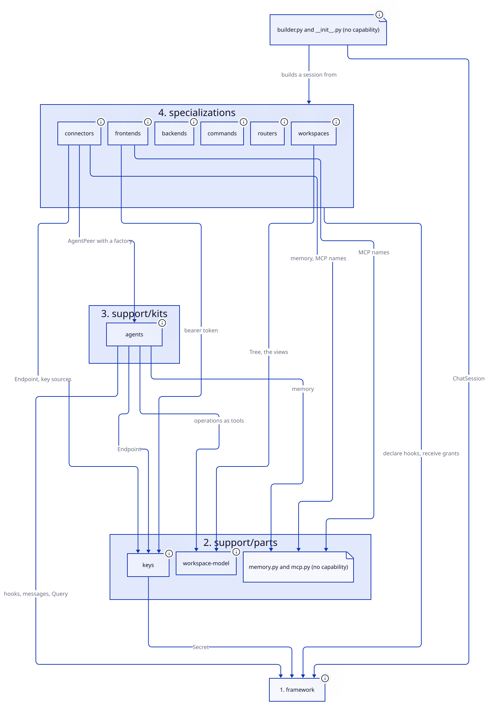

# Architecture: chatinho

## Overview

chatinho is a chat library in which everyone is a peer: a session delivers
messages between peers that declare, with hooks, what they do and what they
need. The package is four layers, each importing only what is below it, and
`tests/test_architecture.py` fails when one reaches up. The core installs
nothing: every battery sits behind an extra and is imported on first use.
`docs/SPEC.md` is the reference for the hooks; `CLAUDE.md` holds the reasons
behind each decision.

## Capabilities and how they interact

1. The framework
   - **framework** (`src/chatinho`: `session.py`, `hooks.py`, `message.py`,
     `query.py`): `ChatSession`, the seventeen hooks and `@require`, the
     messages and the `Query` over the conversation. Uses nothing else. Every
     other capability declares its hooks here and is granted `say`, `ask`,
     `context` and the rest by the session.
2. The parts (`support/parts`, standard library only, none imports another)
   - **keys**: key sources read late and `Endpoint`. Uses the framework's
     `Secret`. Used by connectors, frontends and agents.
   - **workspace-model**: what a workspace is: `Tree`, `@operation`,
     `WorkspaceView` and `Workspace`. Used by workspaces (which makes them) and
     agents (which turns the operations into tools).
   - `memory.py` and `mcp.py` have no capability: they are what two
     specializations share, and carry the tags of whoever they serve.
3. The kits (`support/kits`, may need an extra)
   - **agents**: `AgentPeer`, the chat around an agent, with its factories,
     tools and `WorkspaceBackend`. Uses the framework, keys, workspace-model
     and `memory.py`. Used by the agent connectors.
4. The specializations (never import one another)
   - **connectors**: the peers that answer: `OpenAIConnector`, `McpConnector`,
     and the agent connectors, each `AgentPeer` with a factory. Uses agents,
     keys, `memory.py` and `mcp.py`.
   - **frontends**: who speaks for the person: `ChatFrontend` (the only
     package that imports Textual) and `McpFrontend`. Uses keys and `mcp.py`.
   - **backends**: `DatabaseBackend`, a peer that listens, loads, forgets, and
     keeps and links attachments. Uses the framework only.
   - **commands**: `/help`, `/test` and `/ws`. Uses the framework only; `/ws`
     is handed its provider.
   - **routers**: who answers a say that names nobody: `SimpleRouter`, the
     builders' default, and `LLMRouter`, which keeps its rules and asks an
     OpenAI-compatible model when two or more peers could answer. Uses the
     framework, and the keys and memory parts; `LLMRouter` sits behind
     `chatinho[openai]`.
   - **workspaces**: `GitWorktrees`, the provider: one git worktree per peer.
     Uses workspace-model.

`builder.py` and `__init__.py` are the assembly, with no capability of their
own: the public API and the two builders, the only files that see all four
layers.

## Architectural decisions

- **Four layers, enforced by a test**: the framework imports only itself; a
  part imports the framework and the standard library, and no other part; a
  kit imports the framework and the parts; a specialization imports all three
  and never another specialization. (adopt)
- **What a workspace is sits apart from who provides one**: the agents use
  `support/parts/workspace` and must not need `workspaces/git.py`. (adopt)
- **Everything declares what it does**: a peer or a command is a plain class
  with `@require`, checked at class definition; the session tells roles apart
  by what was declared. The two base classes, `WorkspaceView` and `AgentPeer`,
  exist because a subclass reuses their behaviour. (adopt)
- **A command, a router and a workspace provider are not peers**: no id, in
  nobody's roster, granted only what they declare. (adopt)
- **Nothing blocks**: everything is a coroutine and each delivery is its own
  task; blocking work goes to a thread. (adopt)
- **The core installs nothing**: names that need a library resolve on first
  use and a missing extra is an `ImportError` that names it. (adopt)
- **Tests mirror the capabilities**: `tests/<capability>/`, with what crosses
  capabilities at the root of `tests/`. (adopt)

## Glossary

- **Peer**: a participant with an id and a visible name; `LOCAL` (zero) is the
  person.
- **Hook**: one declared demand (a method the peer writes) or grant (a
  callable the session hands it); never both.
- **Say / ask / invoke**: a message for everyone, a message one peer answers,
  a command run by name.
- **Frontend**: the peer that speaks for the person (peer zero).
- **Backend**: the peer that remembers the conversation and keeps attachments.
- **Connector**: any other peer the session numbers from one.
- **Command**: something that runs when invoked and answers as `TOOL`.
- **Router**: what fills in `to` for a say that names nobody.
- **Workspace**: a peer's own git worktree; its owner gets a `Workspace`,
  anyone else a `WorkspaceView`.
- **Provider**: what makes workspaces (`GitWorktrees`).
- **Part**: shared code on the standard library alone.
- **Kit**: what a specialization is built from, possibly behind an extra.
