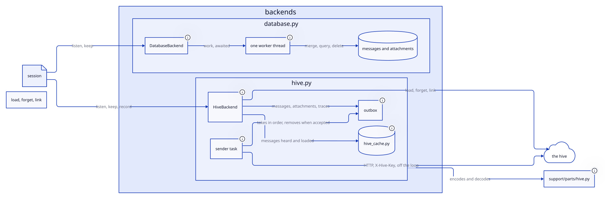

# Design: backends

## Overview

`backends` holds the archive: `DatabaseBackend` in `database.py`, behind
`chatinho[sql]`. It is a peer, `@backend("database")`, that declares
`HookListen` to hear the whole conversation and write every message,
`HookLoad` to give it back when a session starts, `HookForget` to drop it,
and `HookKeep`/`HookLink` to store what messages attach and hand back a
`file://` link to it. It keeps two tables, `messages` and `attachments`, in
any database SQLAlchemy reaches.

`HiveBackend` in `hive.py` does the same in a hive, over HTTP, and records
traces (`HookRecord`). It needs no extra: `urllib` on a thread, an outbox the
sender task empties in order, and, with `cache=`, a SQLite file
(`hive_cache.py`) holding a copy of the chat and the outbox. The JSON it sends
is `support/parts/hive.py`'s, shared with the hive.

## Decisions

- **The archive is a peer that listens, not a store the session pushes at**
  (REQ-BACK-001, REQ-BACK-005). The conversation crosses it as it crosses
  anyone, and the session asks whoever declared `HookLoad` for the older
  tier at `start()`, so a chat reopens where it left off. (baseline-backends)
- **All database work runs on one thread of its own** (REQ-BACK-001,
  REQ-BACK-004). SQLAlchemy is synchronous, so nothing runs on the loop; and
  the session delivers messages concurrently while an in-memory SQLite is
  one shared connection (`StaticPool`, `check_same_thread` off), so a single
  worker runs every call whole and in order. (baseline-backends)
- **A message's id is its primary key** (REQ-BACK-001, REQ-BACK-005). Ids are
  unique across chats, so hearing a message again is a merge, not a second
  row, and a reopened chat never overwrites what it archived.
  (baseline-backends)
- **The status is archived** (REQ-BACK-001). Without it a failed reply came
  back from a reopened archive as an answer and reached a model's memory.
  (baseline-backends)
- **Old archives are read as they are, never migrated** (REQ-BACK-008). A
  table that still has the `asked_of` column loads and saves; the column is
  left unread. (baseline-backends)
- **Attachments are rows; a file exists only when linked** (REQ-BACK-007).
  `(msg_id, name)` is the key, so keeping twice is a no-op. The file is
  written on the first `link`, under a quoted and prefixed name so no name
  leaves its folder and `.`/`..` are files, into a temporary directory
  removed at `shutdown()`. `forget` drops a message's attachments with it
  (REQ-BACK-003). (baseline-backends)
- **HiveBackend speaks HTTP with the standard library** (REQ-BACK-009). A
  chat installs nothing to be kept in a hive; `httpx` would have been an extra
  for every chat. The key is read from its source on every request.
  (add-observer-server)
- **Everything written goes to an outbox, and one task sends it**
  (REQ-BACK-011, REQ-BACK-012). `listen`, `keep` and `record` only queue, in
  call order, so a slow or absent hive holds up nobody; the sender batches up
  to 100, waits 0.5s doubling to 30s on a failure, drops the oldest past
  `queue_limit` with a warning, and drops without retrying what a refused key
  sent: one error, naming the URL and never the key. `forget` cannot wait, so
  it raises `HiveUnavailable`. (add-observer-server)
- **The cache is the outbox and a mirror** (REQ-BACK-013). With `cache=` the
  outbox is a table of the file, so a restart resumes it, and every message
  heard or loaded is kept, so `load` and `link` answer from it when the hive
  cannot. A file made for another hive's URL is refused. (add-observer-server)
- **The hive shows names**: each record carries `frm_name` from `peers()`
  when sent, since ids last one session. (add-observer-server)
- **An unknown keyword is an error** (REQ-BACK-004). `ecoh=True` used to be
  swallowed into a config nothing read. (baseline-backends)

## Interfaces

- `DatabaseBackend(database_url: str, echo: bool = False)`: `@backend("database")`,
  declaring `HookListen`, `HookLoad`, `HookForget`, `HookKeep` and `HookLink`.
  - `initialize()`: opens the engine, starts the worker, creates the tables.
  - `shutdown()`: stops the worker, disposes of the engine, removes the
    linked files.
  - `async listen(msg: ChatMessage) -> None`
  - `async load(since: Optional[datetime] = None, limit: Optional[int] = None) -> List[ChatMessage]`:
    oldest first; `limit` keeps the newest that many.
  - `async forget(before: Optional[datetime] = None) -> int`: how many
    messages were dropped.
  - `async keep(msg_id: MessageID, attachments: Sequence[Attachment]) -> None`
  - `async link(msg_id: MessageID, name: str) -> Optional[str]`: a `file://`
    URI, or `None` for a name never kept.
- `HiveBackend(url, key, *, cache=None, timeout=10.0, queue_limit=10000,
  flush_timeout=3.0)`: `@backend("hive")`, declaring `HookListen`,
  `HookLoad`, `HookForget`, `HookKeep`, `HookLink`, `HookRecord`, `HookPeers`;
  the same methods as `DatabaseBackend` plus `async record(trace)`; `link`
  returns a local path. `HiveUnavailable(ConnectionError)` from `forget`;
  `ValueError` for a URL that is not `http(s)`, a non-positive limit, or a
  cache made for another hive.
- `HiveCache(path, url, limit)` and the `Outbox` protocol (`MemoryOutbox`, or
  the cache's own) in `hive_cache.py`.
- Tables: `messages` (`id`, `text`, `frm`, `to`, `reply_to`, `timestamp`,
  `status`) and `attachments` (`msg_id`, `name`, `media_type`, `data`).
- Errors: `RuntimeError` when used before `initialize()`; `TypeError` for an
  unknown constructor keyword.

## Constraints

- A specialization: it imports the framework only, never another
  specialization (`tests/test_architecture.py`).
- `sqlalchemy` is imported only by `database.py`, behind `chatinho[sql]`,
  which the package imports lazily; `hive.py` and `hive_cache.py` are
  standard library only.
- Nothing blocks the loop: every SQLAlchemy call runs on the worker thread.
- The session's `context()` is synchronous, so what a session sees is what
  `load` returned at `start()`, bounded by `recall` (REQ-BACK-005).
