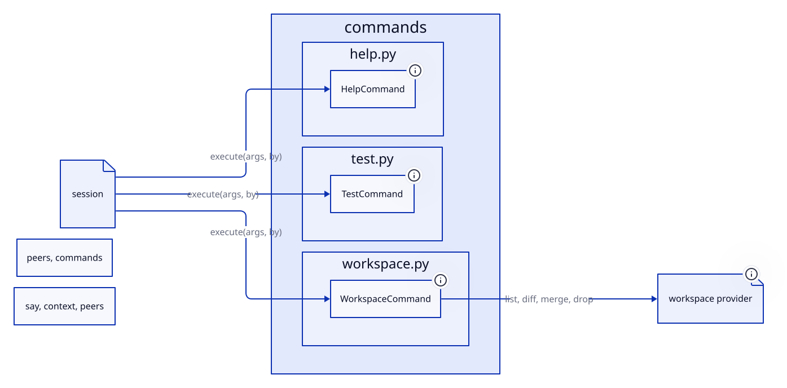

# Design: commands

## Overview

`commands` holds the commands the library ships: `/help` (`help.py`),
`/test` (`test.py`) and `/ws` (`workspace.py`). A command is not a peer: it
declares `HookExecute`, has no id, hears nothing, and runs when someone
invokes it; what `execute` returns is posted by the session as `TOOL`,
replying to the invocation. `/ws` is handed the session's workspace provider
and lets the user list, diff, merge and drop the peers' workspaces.

## Decisions

- **`/ws` is passed like any command; the builders add none**
  (REQ-CMD-005). A builder given `workspaces=` used to add it, and that was
  removed for the reason the session holds no default router: a rule nobody
  chose does not belong in the assembly. (baseline-commands)
- **Only the user merges or drops** (REQ-CMD-003). Merging changes the base
  and dropping discards unmerged work, so both raise `PermissionError` unless
  `by == LOCAL`. It is a check in the command, not structure: an agent has
  `run_ws` like any command, and can look but not merge. (baseline-commands)
- **A diff is an attachment, not the answer's text** (REQ-CMD-002). The
  answer links `<name>.diff`, of type `text/x-diff`, which the session hands
  to the backend before posting. (baseline-commands)
- **Refusals are exceptions** (REQ-CMD-004): `ValueError` for an unknown
  subcommand or a missing name, `KeyError` for a name that is no workspace,
  so whoever ran the command learns why. (baseline-commands)
- **A command answers by returning** (REQ-CMD-005). `/help` returns its
  listing rather than saying it, so it is in the log once; `/test` declares
  `HookSay` only for the progress it says while it runs.
  (baseline-commands)

## Interfaces

- `HelpCommand()`: `@tool("help", ...)`, declaring `HookExecute`, `HookPeers`
  and `HookCommands`. `async execute(args="", by=LOCAL) -> Reply`: the
  commands with their descriptions, then who else is connected.
- `TestCommand()`: `@tool("test", ...)`, declaring `HookExecute`, `HookSay`,
  `HookContext` and `HookPeers`. `async execute(args="", by=LOCAL) -> Reply`:
  says each check, answers `Checks done, for peer <by>.` (no requirement yet).
- `WorkspaceCommand(provider)`: `@tool("ws", ...)`, declaring `HookExecute`.
  `async execute(args="", by=LOCAL) -> Reply`:
  - `""`: each workspace with `peer/<name>` and how many commits it is ahead
    of the base, or `No workspaces yet.`;
  - `diff <name>`: `<name>'s work: [<name>.diff](<name>.diff)` with the diff
    attached;
  - `merge <name>`, `drop <name>`: what was done.
  - Raises `ValueError`, `KeyError`, `PermissionError` and the provider's
    `MergeConflict` (naming the files; the base is left as it was).
- The provider it uses: `names()`, `ahead(name)`, `base`,
  `provision(None, name, create=False)`, `merge(name)`, `drop(name)`.

## Constraints

- A specialization: it imports the framework only, never another
  specialization; `/ws` gets its provider as a constructor argument
  (`tests/test_architecture.py`).
- Standard library only; no extra is needed.
- Nothing blocks the loop: the provider's git work is its own to run off it.
