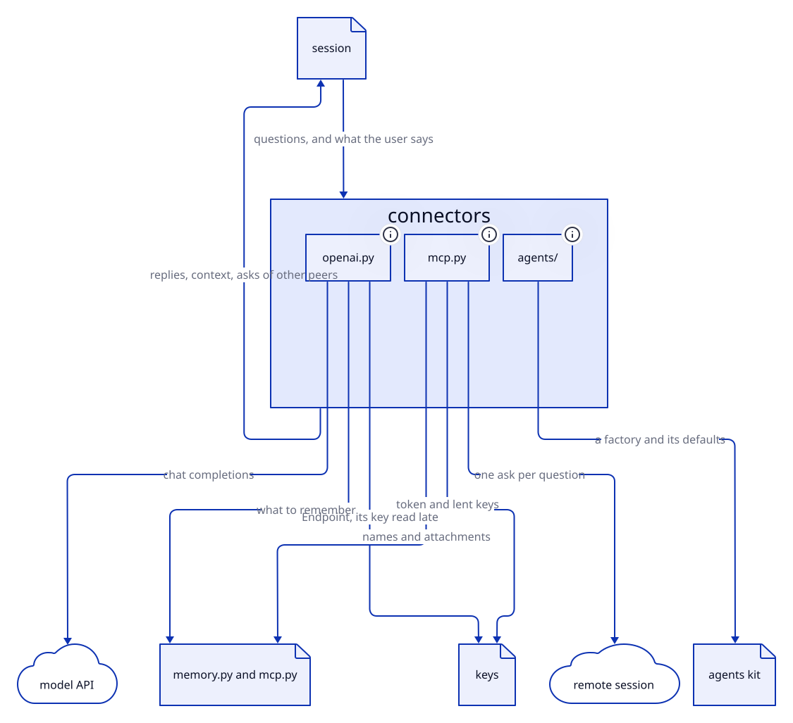

# Design: connectors

## Overview

`connectors` holds the peers that answer. `openai.py` is `OpenAIConnector`,
any OpenAI-compatible chat endpoint as a peer, behind `chatinho[openai]`;
`mcp.py` is `McpConnector`, which asks a remote session over MCP, behind
`chatinho[mcp]`; `agents/` holds `BasicAgentConnector` (`basic.py`, behind
`chatinho[langchain]`) and `DeepAgentConnector` (`deep.py`, behind
`chatinho[deepagents]`), each `AgentPeer` with a factory and nothing else.
Each is a plain class imported on first use. What an agent connector does in
a chat is specified here, and the code of it lives in the agents kit
(`support/kits/agent/`) and `support/parts/memory.py`, which carry this
capability's tags; how `AgentPeer` takes a factory belongs to `agents`.

## Decisions

- **Where to ask, which model and which key are one `Endpoint`**
  (REQ-CONN-002, REQ-CONN-018). `OpenAIConnector` takes one, and an agent
  connector's `model` may be one; unset, requests go to OpenAI itself with
  `gpt-4o`. (baseline-connectors)
- **A key is read when a question needs it, and a lent one wins**
  (REQ-CONN-004, REQ-CONN-018). Nothing reads a key at creation or in
  `initialize()`, so a chat starts without one and a rotated key is used
  without a restart; the credential lent on the message under the
  connector's `credential` name is used for that message only. A key never
  appears in a reply or in the logs. (baseline-connectors)
- **Failures are answers** (REQ-CONN-005, REQ-CONN-009, REQ-CONN-012). A
  failed request, a missing key, an unreachable server and a failed run each
  become an `error` reply naming the connector and the kind of failure;
  every question is answered exactly once. (baseline-connectors)
- **Memory is a `Query` handed to `context()`** (REQ-CONN-003,
  REQ-CONN-017). The connectors keep no conversation: the default is
  `Query(peer=SELF, errors=False).last(20)`, the connector's own replies are
  assistant messages, and other peers are user messages prefixed with their
  name. An agent also gets the message each of its own replies answers, even
  when the query left it out. (baseline-connectors)
- **One OpenAI client per key** (REQ-CONN-006). Questions asked at once share
  it, and the client of an old key is closed only once no question is using
  it. (baseline-connectors)
- **`McpConnector` only answers, and keeps no connection** (REQ-CONN-007,
  REQ-CONN-008). It is built from exactly one server, does not listen to the
  room, and sends each question as one ask of the remote peer: the `peer`
  given, or the only remote peer that answers. (baseline-connectors)
- **Credentials are lent only when told to** (REQ-CONN-010). `delegate` maps
  a credential's name to a value, a function or a key source; only the
  configured ones the server declared are sent, with the question and never
  in its text. (baseline-connectors)
- **Each request is logged with how long it took and how it went**
  (REQ-CONN-025). `OpenAIConnector` and `McpConnector` log the message's id,
  the model or server, the duration and the reply's status; a failure names
  the error's type only, since a remote message may repeat the conversation
  (found in review). Never the prompt, the answer or a key. (add-logging)
- **An agent connector is a constructor** (REQ-CONN-011, REQ-CONN-020,
  REQ-CONN-024). It passes its factory's keyword arguments on unchanged and
  refuses the others at creation; what one does in a chat holds for the
  other. Deep agents' own `memory` is `agent_memory`, because `memory` is
  the chat's query. (baseline-connectors)
- **One question, one run** (REQ-CONN-012, REQ-CONN-013, REQ-CONN-014). The
  chat's memory and the question become the agent's messages, the agent
  runs, the answer is checked for links to the run's files (the model is
  reminded at most `link_retries` times), and the text and files become the
  reply; the files are attached whether or not they are linked.
  (baseline-connectors)
- **A say of the user gets a say; a question gets an answer**
  (REQ-CONN-015). An agent connector responds to what the user says with
  `to` unset, not to other peers' says, and never to a message it also
  answers as a question. (baseline-connectors)
- **The chat is the agent's tools** (REQ-CONN-016, REQ-CONN-019).
  `ask_<peer>`, `run_<command>` and, when asked for, `ask_user`, as the chat
  is when the question is asked; with `workspace=True`, `ws_<op>` and
  `ws_<op>_of` from the operations the provider's classes declare.
  (baseline-connectors)
- **A deep agent's workspace is its backend** (REQ-CONN-020 to
  REQ-CONN-023). Its own workspace is at `/` and each other peer's existing
  one at `/peers/<name>/`, read-only, and its prompt begins by saying so; a
  `backend` option is refused, since taking one would step outside the
  one-writer rule. It gets `ws_` tools only for what its own file tools do
  not reach. Without a provider it runs on deep agents' default backend.
  (baseline-connectors)
- **A run that stops for a decision is an error** (REQ-CONN-024). Nothing in
  the chat resumes a run, so an interrupted one is answered as interrupted.
  (baseline-connectors)

## Interfaces

- `OpenAIConnector(name, endpoint=None, *, temperature=0.7, max_tokens=None,
  system=None, memory=MEMORY, credential="llm")`: declares `HookAnswer`,
  `HookContext` and `HookPeers`; `answer(msg) -> Reply`.
- `McpConnector(*, url=None, token=None, server=None, name=None, peer=None,
  delegate=None)`: declares `HookAnswer`; `answer(msg) -> Reply`.
- `BasicAgentConnector(name, model, tools=(), **options)`: `AgentPeer` with
  `BasicAgent()`; the options are the chat's (`memory`, `peers`, `commands`,
  `ask_user`, `link_retries`, `workspace`) and `create_agent`'s.
- `DeepAgentConnector(name, model, tools=(), *, workspace=True,
  agent_memory=None, **options)`: `AgentPeer` with `DeepAgent(agent_memory)`;
  the options are the chat's and `create_deep_agent`'s.
- Errors: `ValueError` (`McpConnector` given no server, both, or a URL
  without a token), `TypeError` (an option the factory does not take, or
  `backend` on `DeepAgentConnector`). Everything that fails on a question is
  a `Reply` with status `error`.

## Constraints

- A specialization: it imports the framework, the parts and the kits, never
  another specialization; `tests/test_architecture.py` enforces it.
- Each connector sits behind its own extra and is imported on first use.
- Nothing blocks the loop, and a connector may be called concurrently: it
  keeps no conversation state and reads memory from `context()`.
