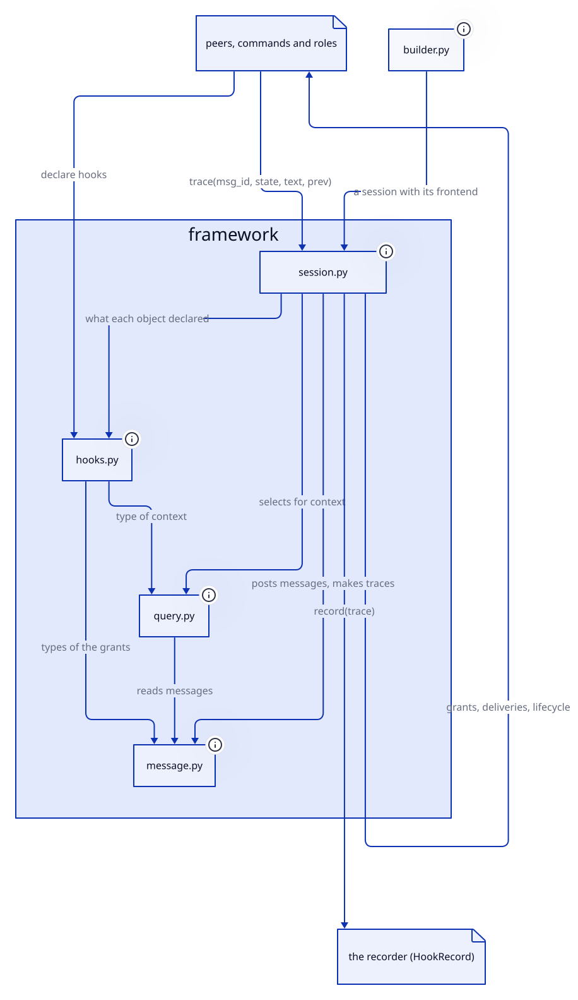

# Design: framework

## Overview

The framework is the chat itself: `ChatSession` registers peers, commands and
roles by what they declared, delivers every message between them, and grants
each one the callables of the hooks it asked for. It is four modules on the
standard library alone (`session.py`, `hooks.py`, `message.py`, `query.py`)
and imports nothing else of chatinho. `builder.py` and `__init__.py` are the
assembly on top of it: the two builders and the public names.

## Decisions

- **An id routes, a name is shown** (REQ-CORE-001, REQ-CORE-002). The
  frontend is `LOCAL` (zero); the session numbers the others from one, never
  going back to an id freed below the next it would give. Why: routing on the
  display name broke replies in flight when a peer was renamed. Alternative:
  the name as the address. (baseline-framework)
- **A peer may say what it is for** (REQ-CORE-002). `@connector(name,
  description=)` writes `description` on the class beside `name`, so an
  instance overrides it the same way; it is empty by default and a
  non-string is a `ValueError`. A router that chooses between peers reads it
  (`LLMRouter`). Why on the peer rather than in the router: it travels with
  the peer and survives a rename. Alternative: a `descriptions=` mapping given
  to the router. (add-llm-router)
- **Roles are told apart by what was declared** (REQ-CORE-003, REQ-CORE-004,
  REQ-CORE-005, REQ-CORE-026). A peer, a command, the router and the workspace
  provider are plain classes with stacked `@require`, checked when the class
  is declared; the session grants exactly the declared callables, bound to
  the peer's own id. Why: a misspelled method is an import error, and no peer
  can speak in another's name. Alternative: base classes and `isinstance`.
  (baseline-framework)
- **`to` is the one field that says who answers** (REQ-CORE-009,
  REQ-CORE-011, REQ-CORE-012). `answer` is called exactly when a message's
  `to` is that peer; an answer and an error reply are addressed to nobody, so
  they are heard and never answered. Alternative: a second field for whose
  `answer` the session called, which every reader had to know about.
  (baseline-framework)
- **`ask` returns the answer's `Reply`, status and all** (REQ-CORE-007,
  REQ-CORE-010), and only the asked peer resolves it (REQ-CORE-008). An
  `answer` returning `None` answers later with a say whose `reply_to` is the
  question. Alternative: returning the text alone, which hid an error from the
  asker. (baseline-framework)
- **A failing `answer` is always answered with an `error` reply**
  (REQ-CORE-007, REQ-CORE-011). When `answer` raises, or returns anything but
  a `Reply` or `None`, the session posts `<peer> failed: <error type>` in that
  peer's name, status `error`, replying to the question and addressed to
  nobody, whether or not an `ask` waits; a waiting `ask` is resolved by that
  reply through the same path as any answer, and never raises the peer's
  error. The text names the type, never the message, which may echo a
  prompt; the failure is still logged with its traceback. `ask` raises only
  for its own failures: `ValueError` for an id that is no peer, and
  `RuntimeError` when the chat closes while it waits. Alternative: raising
  the peer's error in the asker, which left the question unanswered in the
  conversation and made every caller catch another peer's exceptions, or
  resolving the waiting future directly, a second resolution path.
  (fix-ask-failure-reply)
- **A command is not a peer** (REQ-CORE-013). Its invocation is a message
  addressed to `TOOL`, and what `execute` returns is posted from `TOOL`,
  replying to it and addressed to nobody. Why: nobody answers somebody
  else's `/command`. Cost: a command cannot answer privately.
  (baseline-framework)
- **Every delivery is its own task, with no queues** (REQ-CORE-014,
  REQ-CORE-015). Posting returns once the message is in the conversation; a
  peer may be called for several messages at once; asks may recurse up to
  `max_depth` (8), past which the question gets an `error` reply.
  Alternative: a queue per peer, which makes a busy peer hold up its asker.
  (baseline-framework)
- **Lifecycle is not a hook** (REQ-CORE-016, REQ-CORE-017). `initialize`,
  `serve` and `shutdown` are called when present, sync or async. The first
  `serve` to return ends the chat; `close()` waits `CLOSE_TIMEOUT` for the
  deliveries in flight, then cancels, and always returns.
  (baseline-framework)
- **A `Query` is the one way to narrow `context`** (REQ-CORE-018,
  REQ-CORE-019, REQ-CORE-020). `context` is synchronous, so its reach is
  what was said this session plus the `recall` messages loaded at `start()`.
  Alternative: keywords beside the query, which gave "since" and "how many"
  two spellings. (baseline-framework)
- **A message is text; attachments go to the keeper** (REQ-CORE-023,
  REQ-CORE-024). The session hands them to the backend that declares
  `HookKeep`, under the new message's id, before anyone hears the message;
  `locate` asks the backend that declares `HookLink`. With no keeper they are
  dropped. (baseline-framework)
- **Credentials ride on the message, not on a hook** (REQ-CORE-025), wrapped
  in `Secret`, so each message may bring different keys and whoever lent
  them can clear them. (baseline-framework)
- **A workspace's owner is a name, and a missing provider is an error**
  (REQ-CORE-027). Ids last one session and the work outlives it; with no
  provider the grant raises `NoWorkspaceProvider` instead of answering
  `None`. (baseline-framework)
- **A trace is a record beside the message, made by the session**
  (REQ-CORE-030 to REQ-CORE-033). `HookTrace` grants `trace(msg_id, state,
  text, prev=None)`; the session makes the id, stamps who and when, refuses a
  `prev` it never issued, cuts the text at `TRACE_TEXT_LIMIT`, and awaits the
  first `HookRecord` declarer's `record`, as attachments go to `keep`. Traces
  as messages with a status were set aside: they would have entered
  `context()`, every model's memory and the terminal log. A recorder that
  raises is logged and the step goes on. (add-observer-server)
- **A chat that runs writes a log when asked to; nothing else configures
  logging** (REQ-CORE-034). Logging is off unless `CHATINHO_LOG_PATH` names a
  directory: unset or empty, nothing is written and nothing about logging
  changes. `run()` calls `open_log()` (`logs.py`, a framework module because
  the framework imports only itself), which reads the variable itself, so
  nothing else can turn logging on, and sends every `chatinho` record from
  DEBUG up to `chatinho.<date>.log` in that directory, appended to, through a
  `QueueListener` thread so a slow disk never holds up the loop. A missing
  directory is made with its parents, each owner-only (0700); a file it
  creates is owner-only (0600) and an existing one keeps its mode. Opened once
  per process. The variable is the only switch, by decision: the first round
  wrote to the temporary directory on every run, and was reopened as the wrong
  default. Importing chatinho and driving `start`/`close` open nothing.
  (add-logging)
- **The program's logging gets what it got before** (REQ-CORE-034). The
  `chatinho` logger goes to DEBUG for the file and stops propagating; a
  handler of its own forwards a record to the root logger only at the level
  the program gave `chatinho`, or else the root's, read at each record.
  Leaving propagation on would flood a program's console, since `basicConfig`
  sets the level on the logger, not the handler. (add-logging)
- **Records carry ids, counts, states and durations, never text or keys**
  (REQ-CORE-035, REQ-CORE-036). The session logs attach, `started` (naming the
  roster as `name=id`, since peers are attached before `run()` opens the
  file), `closed`, every `posted` message, each ask `answered` with its
  status, each command `ran`, each routing decision and each `forgot`. A
  traceback is logged as the exception wrote it. (add-logging)
- **The core installs nothing** (REQ-CORE-028, REQ-CORE-029). A name behind
  an extra resolves when first read off the package, and a missing extra is
  an `ImportError` that names it. The defaults (a frontend, `SimpleRouter`)
  live in the builders, not in the session. (baseline-framework)

## Interfaces

- `ChatSession(connectors=, commands=, frontend=, backend=, router=,
  workspaces=, recall=200, max_depth=8)`: `run`, `add_connector`, `add_command`, `start`, `close`,
  `id_of`, `forget`.
- Declaring (`hooks.py`): `@connector(name, id=, description="")`, `@tool(name,
  description)`, `@frontend(name="chat")`, `@backend(name)`, `@require(hook,
  **options)`; reading back with `hooks_of`, `options_of`, `declares`,
  `declared_id`, `name_of`.
- The nineteen hooks. Demands: `listen`, `answer`, `execute`, `route`,
  `load`, `forget`, `keep`, `link`, `provision`, `record`. Grants: `say`,
  `ask`, `invoke`, `context`, `peers`, `commands`, `locate`, `workspace`,
  `trace`, typed by the protocols `Say`, `Ask`, `Invoke`, `Context`, `Peers`,
  `Commands`, `Locate`, `WorkspaceGrant`, `Trace`. `docs/SPEC.md` is the reference.
- Data (`message.py`, `query.py`): `ChatMessage` (`id`, `frm`, `to`,
  `reply_to`, `status`, `credentials`), `MessageID` (`parse`, `short`),
  `MessageStore`, `Reply`, `ReplyStatus`, `Attachment`, `Secret`, `LOCAL`,
  `TOOL`, `Query` (`peer`, `thread`, `errors`, `since`, `limit`, `last`),
  `SELF`; `ChatTrace` (`id`, `msg_id`, `state`, `text`, `frm`, `prev`,
  `timestamp`), `TraceID` (`new`, `parse`; `trc-` and 16 hex), `TraceState`
  (`running`, `done`, `error`), `TRACE_TEXT_LIMIT` (2000).
- Builders (`builder.py`): `build_chat_session`, `build_mcp_session`, each
  returning a `ChatSession` with its frontend.
- Errors: `ValueError` (an id taken, an unknown peer, a bad name or status),
  `TypeError` (a bad declaration, a string where a `Reply` is due),
  `KeyError` (no such workspace), `NoWorkspaceProvider`, `ImportError`
  naming the missing extra.
- `logs.py`: `LOG_FORMAT`, `LOG_PATH_VARIABLE` (`"CHATINHO_LOG_PATH"`), `log_file(directory, day=None) -> Path`, `open_log() -> Optional[Path]`, `close_log()`; not exported from `chatinho` (REQ-CORE-034).

## Constraints

- Standard library only, and nothing of chatinho but itself;
  `tests/test_architecture.py` enforces it.
- Nothing blocks the loop: `answer`, `listen` and `execute` await their
  waiting, and blocking work goes to a thread.
- A peer never hears itself.
- A session holds no default router: one built by hand routes nothing until
  it is given one.
