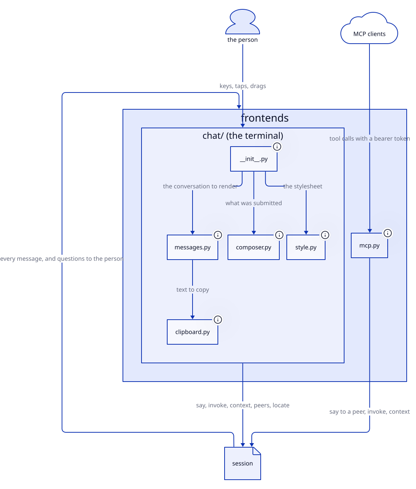

# Design: frontends

## Overview

`frontends` holds who speaks for the person: peer zero of a session.
`chat/` is `ChatFrontend`, the terminal, a Textual app behind `chatinho[tui]`
and the only package that imports Textual: `__init__.py` is the app (keys,
commands, the `@name` ask), `messages.py` the `ChatLog` that renders the
conversation, `composer.py` the multi-line input and its suggestions
(commands after `/`, peers that answer after `@`), `style.py` the `ChatStyle` palette rendered as CSS, and
`clipboard.py` the clipboard helper. `mcp.py` is `McpFrontend`, the session
served over MCP (Streamable HTTP) for clients that ask its peers, behind
`chatinho[mcp]`. Both take no session: `build_chat_session` and
`build_mcp_session` hand each over as the session's `frontend`.

## Decisions

- **A frontend reaches the conversation through the same hooks as any peer**
  (REQ-FRONT-001, REQ-FRONT-010, REQ-FRONT-024). Each is `@frontend`, so peer
  zero, and declares its grants; there is no privileged path.
  (baseline-frontends)
- **The terminal says nothing of its own** (REQ-FRONT-003). The welcome is a
  banner and an unknown or failing command a notification: a say of the
  person's would be routed to a peer and archived. (baseline-frontends)
- **The terminal never waits** (REQ-FRONT-005). What the person sends returns
  once posted, a command runs in a worker, and answers arrive as messages;
  a question to the person is answered late with a reply. (baseline-frontends)
- **A key that cannot arrive is refused when the terminal is built**
  (REQ-FRONT-009, REQ-FRONT-020). `ctrl+h`, `ctrl+i`, `ctrl+m` and `ctrl+[`
  are other keys on the wire; the list is derived from Textual's
  `ANSI_SEQUENCES_KEYS` so it cannot drift. (baseline-frontends)
- **Enter sends; `ctrl+j` or a trailing escape opens a line** (REQ-FRONT-012).
  `ctrl+j` is Line Feed, its own byte, so it needs no enhanced keyboard
  protocol; the escape (a space by default) is looked for at the cursor, so
  a message that ends in it can still be sent. Enter is claimed in `_on_key`,
  because `TextArea` inserts its newline before a binding is reached.
  (baseline-frontends)
- **A bubble is an outline measured in Python** (REQ-FRONT-007,
  REQ-FRONT-011, REQ-FRONT-013, REQ-FRONT-019). `Markdown` reports no width,
  so `ChatLog` measures the widest line in cells, caps it, and clamps with
  `max-width: 100%`; only the reply target is filled. The header is the
  bubble's sibling, in the peer's colour, sized to the bubble's span and
  aligned to its side, and clamped too so it stays visible at phone width.
  (baseline-frontends)
- **A newline typed is a hard break** (REQ-FRONT-018). A core rule rewrites
  every `softbreak` token as `hardbreak`; markdown-it's `breaks` option only
  affects HTML, which Textual never renders. (baseline-frontends)
- **A tap is decided by time and travel, not Textual's chain count**
  (REQ-FRONT-015). A thumb never lands twice on the same cell; a press that
  travelled, or left text selected, is a drag. (baseline-frontends)
- **A drag is split by where it lands** (REQ-FRONT-016). No terminal protocol
  carries the device, so a drag on text selects and one on the background
  pans, measured in screen coordinates. (baseline-frontends)
- **Copying takes two routes** (REQ-FRONT-020). OSC 52 reaches the person's
  terminal, a helper the local clipboard; both run, the helper in a worker,
  and the popup names the routes taken and shows the text. (baseline-frontends)
- **The chrome wears the palette** (REQ-FRONT-014, REQ-FRONT-017,
  REQ-FRONT-021). Scrollbars are styled as properties of the scrolling
  widgets, in one rule for the log and the input, one cell wide with a
  transparent track; the input is ruled off in neutral tones; the chat is
  centred and capped. Every invalid style value is refused when the
  `ChatStyle` is made, not at mount. (baseline-frontends)
- **`McpFrontend` speaks for every client and keeps nothing**
  (REQ-FRONT-025, REQ-FRONT-026). Each `ask` is its own message addressed to
  the peer; only that peer's reply ends the call, read from the conversation
  through `context`, and the first reply ends it once the question is gone.
  (baseline-frontends)
- **Credentials ride on the message, never in it** (REQ-FRONT-028). Declared
  names are announced at discovery; a lent key is set on the question's
  message and cleared when the call ends. (baseline-frontends)

- **One popup, a source per prefix** (REQ-FRONT-023, REQ-FRONT-029).
  `Suggestions` lists commands after a leading `/` and the peers that answer
  after a leading `@`, with one set of keys and one style, so the two cannot
  drift apart. A second widget, or a base class with two subclasses, were
  weighed and refused: duplicated keys and CSS, or a third base class.
  (add-peer-suggestions)
- **An option is the whole completion** (REQ-FRONT-023, REQ-FRONT-029). Its
  id is `/help` or `@sol`, so the input writes back what it takes plus a
  space without knowing which prefix opened the popup. (add-peer-suggestions)
- **The frontend decides who can be asked** (REQ-FRONT-029).
  `ChatFrontend._answering_peers()` reads the roster fresh on every keystroke
  and keeps the peers but `LOCAL` that declare `HookAnswer`; the popup is
  handed plain names. Two peers that share a name are one entry, since an
  option's id must be unique; it asks the first, as typing it does.
  (add-peer-suggestions)

## Interfaces

- `ChatFrontend(title="Chatinho", welcome_message="", max_displayed=100,
  style=None, quit_key="ctrl+q", copy_key="ctrl+y",
  newline_escape=NEWLINE_ESCAPE, name=None)`: a Textual `App`,
  `@frontend("chat")`, declaring `HookSay`, `HookAsk`, `HookListen`,
  `HookAnswer`, `HookContext`, `HookPeers`, `HookCommands`, `HookInvoke`
  and `HookLocate`; `serve()` runs the app until the person quits;
  `has_suggestions()` says whether the input's popup has entries.
- `chat/composer.py`: `Suggestions(commands, peers)`, the popup (id
  `SUGGESTIONS_ID = "suggestions"`); `take_highlighted()` returns the
  completion with its prefix; `PEER_PREFIX = "@"`; `CommandInput`, the input.
- `ChatStyle`: a frozen dataclass (palette, `peer_headers`, `local_align`,
  `input_frame`, `chat_max_width`, `bubble_max_width`, scrollbar fields)
  whose `to_css()` is the stylesheet; tweak with `dataclasses.replace`.
- `McpFrontend(name="master", *, token, host="127.0.0.1", port=8000,
  credentials=None)`: `@frontend("master")`, declaring `HookSay`,
  `HookListen`, `HookPeers`, `HookCommands`, `HookInvoke`, `HookLocate` and
  `HookContext`, not `HookAnswer`; MCP tools `ask(peer, text) -> Answer`,
  `peers() -> List[PeerInfo]`, `tools() -> List[ToolInfo]`,
  `invoke(name, args)`.
- `build_chat_session(...)`, `build_mcp_session(...)` in `builder.py` make a
  `ChatSession` with the frontend in place (REQ-CORE-029).
- Errors: `ValueError` for a key or escape that could never fire, a blank
  name, an invalid style value, or `McpFrontend` without a token; a failing
  MCP call is a tool error, and so is an asked peer's reply with status
  `error`, carrying its text.

## Constraints

- A specialization: it imports the framework, the parts and the kits, never
  another specialization; only `chat/` imports Textual. Both enforced by
  `tests/test_architecture.py`.
- Never a grant or attribute named like a method of the Textual parent
  (`run`, `_context`), which would silently break the app.
- Nothing blocks the loop: helpers and HTTP run off it or as tasks.
- Phone terminals (Termux) are a target: widths down to 40 columns and keys
  without the enhanced keyboard protocol.
