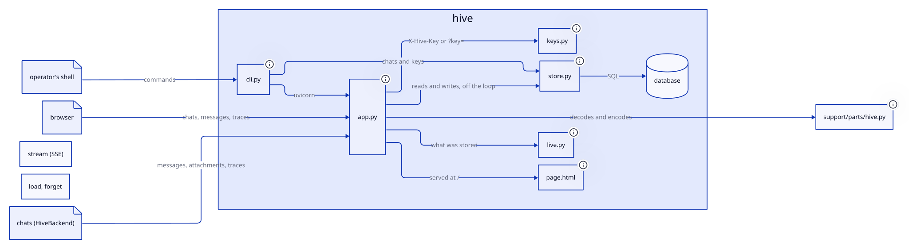

# Design: hive

## Overview

The hive is the server every chat is kept and seen in. A chat, by its name
and key, writes its conversation, attachments and traces through
`HiveBackend` and reads them back; an admin opens the page at `/`, lists the
chats, watches one live and reads the trace graph of any message. It is a
FastAPI app over one SQL database, behind `chatinho[hive]`, run with
`chatinho-hive serve`.

## Decisions

- **FastAPI, SQLAlchemy and server-sent events, not Django** (REQ-HIVE-007,
  REQ-HIVE-009). Async like the session, mostly dependencies the lock already
  had (Starlette, uvicorn, pydantic through `chatinho[mcp]`, SQLAlchemy
  through `chatinho[sql]`), and documented pages for free. Django was set
  aside: synchronous at heart, and live updates would need Channels and Redis.
  (add-observer-server)
- **The hive is a chat's backend, not only an observer** (REQ-HIVE-004). It
  stores and gives back, so a chat reopened anywhere has its history; an
  observer would have left two records of every chat. (add-observer-server)
- **A chat is a name and a key, made by a command** (REQ-HIVE-001,
  REQ-HIVE-002, REQ-HIVE-003). `chatinho-hive chat add` prints the key once
  and the database keeps its SHA-256, which is also the index a request's key
  is found by; a key is 192 random bits, so a slow hash protects nothing. A
  chat key reads and writes its own chat and never learns another exists; an
  admin key reads every chat and writes none. There is no remote admin API to
  secure. (add-observer-server)
- **The store is synchronous SQLAlchemy behind async routes** (REQ-HIVE-004,
  REQ-HIVE-005). Routes call it with `run_in_threadpool` and publish what was
  really inserted to `Live`, one `asyncio.Queue` per open stream; a resend is
  skipped by its id, so it is neither stored nor streamed twice.
  (add-observer-server)
- **The stream takes its key as `?key=` too, and the access log masks it**
  (REQ-HIVE-003, REQ-HIVE-007). A browser's `EventSource` sets no headers;
  uvicorn logs every path with its query, so a filter on `uvicorn.access`
  writes `?key=***` (found in review). (add-observer-server)
- **The page is one static file** (REQ-HIVE-008). HTML, CSS and JavaScript
  with nothing from another host; the admin key stays in the browser's
  `localStorage` with a button that forgets it; a trace's row is its depth
  along `prev`, drawn as SVG. (add-observer-server)

## Interfaces

- `create_app(db_url) -> FastAPI` (`app.py`), with `/openapi.json` and `/docs`:

  | method and path | key | answer |
  |---|---|---|
  | `POST /api/messages` `{"messages": [wire]}` | chat | `{"stored": n}` |
  | `GET /api/messages?since=&limit=` | chat | `{"messages": [wire]}` |
  | `DELETE /api/messages?before=` | chat | `{"forgotten": n}` |
  | `PUT`/`GET /api/messages/{msg_id}/attachments/{name}` | chat | 204 / the bytes, or 404 |
  | `POST /api/traces` `{"traces": [wire]}` | chat | `{"stored": n}` |
  | `GET /api/chats` | admin | `{"chats": [{"name", "created", "messages", "last"}]}` |
  | `GET /api/chats/{name}/messages?since=&limit=` | admin | `{"messages": [wire]}` |
  | `GET /api/chats/{name}/messages/{msg_id}/traces` | admin | `{"traces": [wire]}`, oldest first |
  | `GET /api/chats/{name}/stream` | admin, or `?key=` | SSE: `event: message` or `trace` |
  | `GET /` | none | the page |

  The key is `X-Hive-Key`. 401 for none or an unknown one, 403 for the wrong
  kind, 404 for an unknown chat or message, 422 for a batch that is not one.
- The wire (`support/parts/hive.py`): `message_to_wire`/`message_from_wire`,
  `trace_to_wire`/`trace_from_wire`, `KEY_HEADER`; each record carries
  `frm_name`.
- `chatinho-hive` (`cli.py`, also `python -m chatinho.hive.cli`): `serve
  [--db] [--host 127.0.0.1] [--port 8700]`, `chat add|list|remove`, `admin
  add`, each with `--db` (default `sqlite:///hive.db`).
- `Store(db_url)`, `Caller`, `NameTaken` (`store.py`); `make_key`, `hash_key`
  (`keys.py`); `Live` (`live.py`).
- The page's `data-testid`s: `key`, `key-save`, `chat`, `message`, `graph`,
  `edge` (with `data-from`, `data-to`).

## Constraints

- A specialization: it imports the framework and the parts, never the session
  or another specialization (`tests/test_architecture.py`).
- Behind `chatinho[hive]`; `import chatinho` loads none of it, and importing
  `chatinho.hive` without it is an `ImportError` naming the extra.
- One process over one database; SQLite takes one writer at a time, so writes
  hold a lock.
- A trace may arrive before its message; it is kept either way.
