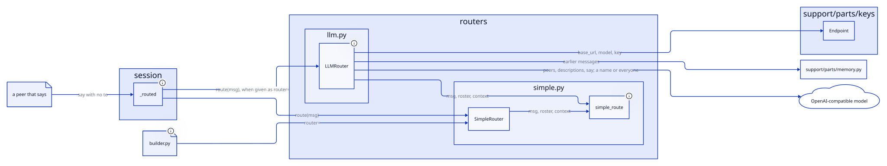

# Design: routers

## Overview

`routers` decides who answers a say that names nobody. When a peer says
something with no `to`, the session hands the say to its router, the one it
was given as `router=`, and what `route` returns is written into the say's
`to` before anyone hears it. The router is a role, not a peer: no id, in no
roster, granted only what it declares. `SimpleRouter` (`simple.py`) is the
one the builders give: a reply goes back to the author of what it replies
to, and any other say to the room's lone answering peer. `LLMRouter`
(`llm.py`, behind `chatinho[openai]`) is opt-in: it keeps those two rules
and, when two or more peers could answer, asks an OpenAI-compatible model
which one, or whether the say is for everyone.

## Decisions

- **`to` is the one field that says who answers, and the router fills it in**
  (REQ-ROUTE-001). It used to be two fields, `to` and `asked_of`, with the
  routing rule fixed inside the session; every reader had to know which to
  look at. Now the route is written into `to` before the say is heard.
  (baseline-routers)
- **The router is a role, not a peer** (REQ-ROUTE-002). It was a peer for a
  while (whoever declared `HookRoute`), which put a `router` in `/help`, in
  the MCP `peers` tool and in every roster, for a role nothing addresses. A
  connector that declares `HookRoute` is not consulted. (baseline-routers)
- **The default lives in the builders, not the session** (REQ-ROUTE-006). A
  `ChatSession` is the bare machinery and a rule nobody chose does not belong
  in it; a session built by hand routes nothing until given a router.
  (baseline-routers)
- **A broken router never silences a say** (REQ-ROUTE-003). A route that is
  not another answering peer is ignored with a warning, a router that raises
  is logged, and the say goes to nobody in both cases. (baseline-routers)
- **An answer is addressed to nobody, which tells a follow-up from an
  answer** (REQ-ROUTE-004, REQ-ROUTE-005). The answer a follow-up replies to
  was addressed to nobody, so `SimpleRouter` routes the follow-up back to its
  author. The cost: a listener that answers only `msg.to is None` stays quiet
  in a room with one answering peer. (baseline-routers)
- **SimpleRouter's rules are one function both routers call**
  (REQ-ROUTE-007). `simple_route` and `answering` hold them, so `LLMRouter`
  cannot drift from `SimpleRouter`. Alternatives: subclassing `SimpleRouter`
  (the library keeps two base classes, deliberately), or holding one and
  copying the grants onto it at each call. (add-llm-router)
- **The model is asked only when there is a choice** (REQ-ROUTE-007). The
  session posts a say only once it is routed, so a model call delays the
  person's own message; a reply to an answering peer, a room with one, and a
  room with none never wait on it. (add-llm-router)
- **The model answers one word** (REQ-ROUTE-008). A peer's name, or
  `everyone`, read ignoring case, a leading `@`, quotes and trailing
  punctuation. Alternatives: JSON or a tool call, which not every
  OpenAI-compatible server supports. (add-llm-router)
- **A failed choice is a broadcast, logged by the router**
  (REQ-ROUTE-009). An unknown or shared name, an API error, a missing key or
  a timeout is a warning naming the reason and never the say or a key, and
  the say goes to nobody; letting it raise would log an error with a
  traceback for an expected outcome. (add-llm-router)
- **A lent key wins, and lives for one say** (REQ-ROUTE-010). As
  `OpenAIConnector` does; its own key is read late and its client kept per
  key, a replaced one closed at shutdown. (add-llm-router)
- **Extra request headers are the router's, fixed when it is built**
  (REQ-ROUTE-012). An endpoint such as the GitHub Copilot API needs headers
  (`Editor-Version`) the SDK does not send; `headers` is copied and checked
  at build time and given as `default_headers` to every client, its own and a
  lent key's. `Authorization` is refused because the SDK merges
  `default_headers` over its own auth header, which would silently replace a
  lent key. Values stay in a private attribute and out of `repr` and logs.
  Alternative: a client factory, which would let `openai`'s type into the API
  and move part of the router's job to the caller. (add-router-headers)

## Interfaces

- `HookRoute`: demands `async route(msg) -> Optional[int]`, the id of the
  peer that answers *msg* (a say with `to` unset), or `None` for nobody.
- `ChatSession(router=...)`: the router must declare `HookRoute`, or
  `TypeError`; it gets the grants it declares, and its `initialize` and
  `shutdown` run with the chat's.
- Not consulted for an addressed say, what a command writes, an invocation
  (addressed to `TOOL`) or its answer, or a late answer to something put to
  its speaker.
- `SimpleRouter()`: declares `HookRoute`, `HookPeers` and `HookContext`; holds
  nothing, so one instance serves a session for its whole life. Neither rule
  counts the speaker or the frontend (`LOCAL`).
- `answering(msg, roster) -> List[int]`, `simple_route(msg, roster, context)
  -> Optional[int]` (`simple.py`): the answering peers but the speaker and the
  frontend, and `SimpleRouter`'s two rules.
- `LLMRouter(endpoint=None, *, memory=ROUTING_MEMORY, timeout=10.0,
  credential="llm", headers=None)` (`llm.py`): declares `HookRoute`,
  `HookPeers`, `HookContext`; `async route(msg)`, `async shutdown()`;
  `ValueError` for a timeout that is not positive, or `headers` that are not a
  mapping of strings or name `Authorization` (in any case); the model is `endpoint.model or
  "gpt-4o-mini"`. `ROUTING_MEMORY` is the last 6 messages without failed
  replies; `EVERYONE` is `"everyone"`. Read lazily off `chatinho` and
  `chatinho.routers`.
- `build_chat_session(router=None)`, `build_mcp_session(router=None)`: a
  `SimpleRouter` when none is given.

## Constraints

- A specialization: imports the framework only, never another
  specialization (`tests/test_architecture.py`).
- `simple.py` is standard library only; `llm.py` needs `openai`
  (`chatinho[openai]`) and is imported only when `LLMRouter` is read.
- `context()` is synchronous, so a reply's parent is found only in the window
  the session recalled; one older than that routes to nobody.
