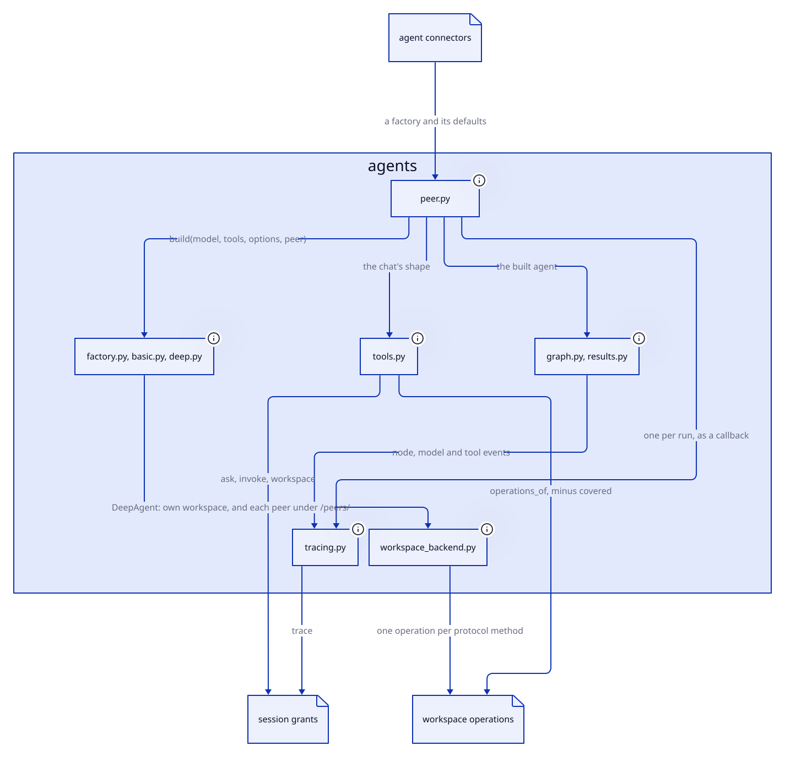

# Design: agents

## Overview

`agents` is what the agent connectors are built from: the chat around an
agent, behind `chatinho[langchain]`. `peer.py` holds `AgentPeer`, a chat peer
that receives a factory and runs the agent it builds; `factory.py` is the
`AgentFactory` protocol, with `BasicAgent` (`basic.py`, `create_agent`) and
`DeepAgent` (`deep.py`, `create_deep_agent`) the two shipped; `tools.py` turns
the chat into the agent's tools (`ask_<peer>`, `run_<command>`, `ask_user`,
`ws_<op>` and `ws_<op>_of`); `graph.py` and `results.py` wrap the agent in
extract, agent, verify and load, and read the answer's text and files; and
`workspace_backend.py` is `WorkspaceBackend`, which hands a workspace to a
deep agent as its file backend, behind `chatinho[deepagents]`. What an agent
peer does in a chat, seen through a connector, belongs to `connectors`.

## Decisions

- **The peer receives a factory, and the factory is what differs**
  (REQ-AGENT-001). `AgentPeer(name, model, factory, ...)` is the whole chat
  around an agent; a factory is any object with a `name`, the `options` it
  accepts, the operations its own tools `cover`, and
  `async build(model, tools, options, peer)`. A third kind of agent is a
  factory passed to `AgentPeer`, with nothing to subclass. Alternative: class
  attributes and overrides on a concrete connector, which spread what makes
  an agent deep across several overrides. (baseline-agents)
- **Built lazily, rebuilt on the chat's shape** (REQ-AGENT-001). `build` is
  never called when the peer is created: it runs at the first question, once
  even for two first questions at once, and again whenever the peers,
  commands or workspaces the tools are made from change. Why: the tools are
  the chat, and the chat is not there at construction. (baseline-agents)
- **The factory says what it accepts** (REQ-AGENT-002). A keyword that is
  neither a chat option nor in the factory's `options` is a `TypeError` at
  creation, naming the factory and the argument, instead of a failure at the
  first question. (baseline-agents)
- **The factory says what its own tools cover** (REQ-AGENT-003). With
  `workspace=True` the agent gets `ws_<op>` for each operation and
  `ws_<op>_of` for each one that reads, except the covered ones: a model
  offered two tools for one thing would have to guess. `workspace` is opt-in
  because hooks are declared by the class, not the instance. (baseline-agents)
- **`AgentPeer` is a base class, deliberately** (REQ-AGENT-001). What a
  connector reuses is the behaviour itself; it only picks a factory and its
  defaults. (baseline-agents)
- **The kit is not in the top-level API, and the basic pieces need no deep
  agents** (REQ-AGENT-004, REQ-AGENT-011). `AgentPeer`, `AgentFactory` and
  `BasicAgent` come from `chatinho.support.kits.agent`; `DeepAgent` resolves
  there on first use, so nothing pulls `deepagents` in until it is asked for,
  and workspaces work without the adapter. (baseline-agents)
- **`WorkspaceBackend` subclasses deep agents' `BackendProtocol`, and is not
  a sandbox** (REQ-AGENT-005). The protocol is an ABC deep agents checks with
  `isinstance`, so the adapter subclasses it and lives in the kit, not in the
  stdlib-only workspace model. `execute` gets deep agents' own "no shell".
  (baseline-agents)
- **Paths are absolute and rooted at the workspace** (REQ-AGENT-006). `/` is
  the workspace's root, in and out, a directory ending with `/`; a path that
  leaves is an error result. (baseline-agents)
- **Results, never exceptions** (REQ-AGENT-007, REQ-AGENT-009). A failure of
  the operation underneath becomes the result's `error`, and a view answers
  writes with an error naming the owner's workspace, because deep agents
  registers `write_file` whatever the backend. (baseline-agents)
- **One operation per protocol method** (REQ-AGENT-008). Every call goes
  through the workspace's operation of the same purpose, so its lock and path
  rules apply. `agrep` is literal, as the protocol says: `re.escape` over the
  workspace's `grep`. (baseline-agents)
- **Async only** (REQ-AGENT-010). The sync methods raise
  `NotImplementedError` instead of reaching into the chat's loop from a
  thread. (baseline-agents)

- **A run is traced through a LangChain callback** (REQ-AGENT-012).
  `RunTracer`, one per run in the run's config, traces the four nodes, every
  model call and every tool call, `running` then `done` or `error`. A step's
  end follows its start; its start follows the last step that ended inside
  the same traced parent, or the parent's start; a tool call follows the end
  of the model call that asked for it, so tools of one turn share that trace
  even when one ends before the other starts (found under load in review).
  A trace that fails is logged and the run goes on. (add-observer-server)

- **A run and a build are logged** (REQ-AGENT-013). Each run with the
  message's id, its duration and its outcome (answered, interrupted, or the
  error's type), and each build of the agent with the factory's name and the
  number of tools; never the question or the answer. (add-logging)

## Interfaces

- `AgentPeer(name, model, factory, tools=(), *, memory=MEMORY, peers=None,
  commands=None, ask_user=False, link_retries=1, workspace=False, **options)`:
  `answer(msg) -> Reply`, `listen(msg)`, `graph()`, and for factories
  `own_workspace() -> Optional[Workspace]` and
  `others_workspaces() -> Dict[str, WorkspaceView]`.
- `AgentFactory` (a protocol): `name: str`, `options: FrozenSet[str]`,
  `covered: FrozenSet[str]`,
  `async build(model, tools, options, peer) -> runnable`.
  `BasicAgent()`; `DeepAgent(agent_memory=None)`.
- `RunTracer(trace, msg_id)` (`tracing.py`): an `AsyncCallbackHandler`;
  `AgentPeer` declares `HookTrace` and passes one per run.
- `chat_tools(peer, shape)` and `workspace_tools(peer, mine, covered)`: the
  `StructuredTool`s of a build.
- `WorkspaceBackend(workspace)`: `als`, `aread(file_path, offset=0,
  limit=2000)`, `aglob(pattern, path=None)`,
  `agrep(pattern, path=None, glob=None, *, max_count=None)`, `awrite`,
  `aedit(file_path, old_string, new_string, replace_all=False)`, `adelete`,
  `aupload_files`, `adownload_files`, each returning the protocol's result
  type.
- Errors: `TypeError` (an option the factory does not take), `Interrupted`
  (a run that stopped for a decision), `ImportError` (`DeepAgent` or
  `WorkspaceBackend` without `deepagents`), `NotImplementedError` (a sync
  backend method).

## Constraints

- A kit: it imports the framework and the parts, never a specialization;
  `tests/test_architecture.py` enforces it.
- Behind `chatinho[langchain]`; `deep.py` and `workspace_backend.py` behind
  `chatinho[deepagents]`, imported lazily.
- Nothing blocks the loop, and a peer may be called concurrently: it keeps no
  conversation state and reads memory from `context()`.
- The backend reaches files only through the workspace's operations.
