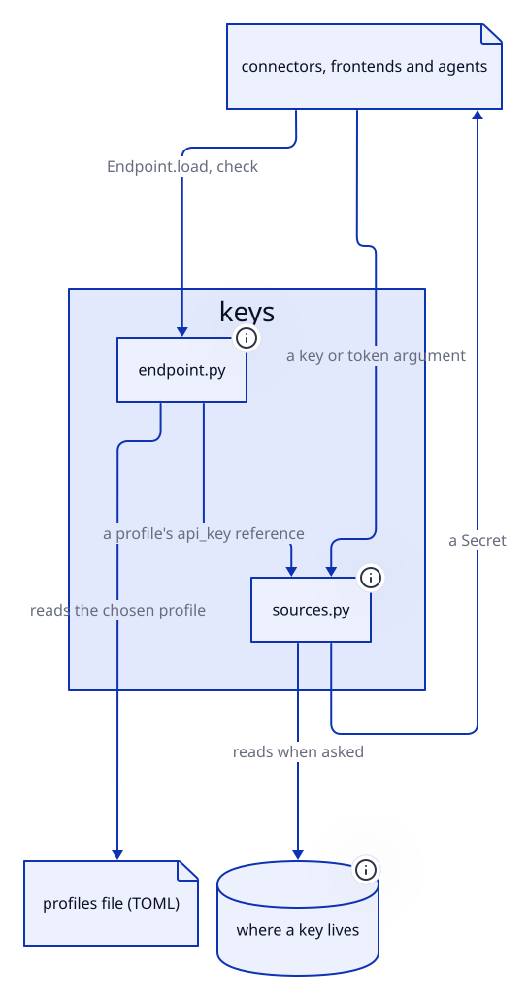

# Design: keys

## Overview

`keys` lets a program say where a key or token lives instead of carrying its
value, and treats an OpenAI-compatible endpoint, its model and its key as one
named profile. It is two modules on the standard library alone: `sources.py`
(the key sources, `key()`, `to_source()`, `read_async()`) and `endpoint.py`
(`Endpoint` and the profiles file), which uses the first for a profile's key.
The only thing it takes from the rest of chatinho is the framework's `Secret`.

## Decisions

- **A source says where the key is and is read late, always as a `Secret`**
  (REQ-KEYS-001). `Env`, `DotEnv` and `File` read the current value each
  time. Why: a rotated key is used without a restart, and a value that is
  never held cannot leak from a `repr`. Alternative: reading the value when
  the program starts and passing the string around. (baseline-keys)
- **A command and the keychain are read once and kept** (REQ-KEYS-002).
  Why: each read may prompt the person or take seconds. Cost: a key rotated
  there is seen only by a new source. A command runs without a shell, with no
  stdin of the chat's. (baseline-keys)
- **An error names the reference, never a value** (REQ-KEYS-003,
  REQ-KEYS-005). `KeyUnavailable` says which variable, file, command or
  keychain entry failed and why; what a failing command printed is left out,
  since it may hold part of a secret. A `Chain` fails only when every source
  did, listing each reason. (baseline-keys)
- **Files are checked for who else can reach them** (REQ-KEYS-004,
  REQ-KEYS-009). On POSIX a key file readable or writable by group or others
  is refused, and so is a profiles file they can write, because a profile may
  name a command to run. (baseline-keys)
- **Reference strings are parsed only by `key()`** (REQ-KEYS-006,
  REQ-KEYS-007). A plain string given as a key argument is the value itself,
  so `to_source("env:X")` yields `env:X`; references are for the profiles
  file, and code builds the objects. Why: a key that happens to look like a
  reference must not be read as one, and a typo in a reference must not be
  sent as a key. A refused reference is not repeated in the error.
  (baseline-keys)
- **Reading is synchronous, and async code goes through `read_async`**
  (REQ-KEYS-007). A keychain or a command may block, so the read goes to a
  thread; only `Literal` and `Env` are read inline. (baseline-keys)
- **An endpoint is an immutable value that never shows its key**
  (REQ-KEYS-008). `with_model` and `without_key` return copies; the key is
  kept as a source and left out of the `repr`. (baseline-keys)
- **One profiles file, the first that exists** (REQ-KEYS-009, REQ-KEYS-010):
  `$CHATINHO_PROFILES`, `.chatinho.toml` in the current directory, then
  `chatinho/profiles.toml` under `$XDG_CONFIG_HOME`. Files are not merged, so
  the project's file hides the user's. The profile is the argument, else
  `CHATINHO_PROFILE`, else the file's `default`; `CHATINHO_MODEL` and
  `CHATINHO_BASE_URL` replace its fields. With no profile chosen the
  endpoint comes from `OPENAI_API_KEY`, `OPENAI_BASE_URL` and
  `CHATINHO_MODEL`. An unknown field or profile is refused by name rather
  than ignored. (baseline-keys)
- **`check()` reads the key and contacts nothing** (REQ-KEYS-012), so a
  missing key is found at startup instead of at the first question.
  (baseline-keys)

## Interfaces

- Sources (`sources.py`): the `KeySource` protocol (`read() -> Secret`);
  `Env(name)`, `DotEnv(path=".env", name)`, `File(path)`,
  `Keyring(service, user)`, `Command(argv)`, `Literal(value)`,
  `Chain(*sources)`.
- `key(reference) -> KeySource`: `env:NAME`, `dotenv:PATH#NAME`, `file:PATH`,
  `keyring:SERVICE/USER`, `cmd:COMMAND`, `literal:VALUE`.
- `KeyLike`: what a key or token argument accepts (a string, a `Secret`, a
  function, a key source). `to_source(value) -> Optional[KeySource]`;
  `async read_async(source) -> Secret`.
- `Endpoint(base_url=None, model=None, api_key=None, profile=None)`: `key`,
  `with_model(model)`, `without_key()`, `check()`,
  `Endpoint.from_env(prefix="OPENAI")`, `Endpoint.load(profile=None)`;
  `profiles_file()` gives the file in use.
- Profiles file (TOML): an optional top-level `default`, and one table per
  profile with `base_url`, `model` and `api_key` (a reference string).
- Errors: `KeyUnavailable` (a source cannot yield a key, or an endpoint has
  none), `ValueError` (a bad reference, an unknown profile or field, a
  profiles file that is missing, invalid or writable by others), `TypeError`
  (a key argument of another type).

## Constraints

- Standard library only, and no other part: `tests/test_architecture.py`
  enforces it. `Keyring` imports `keyring` only when read, and its absence is
  a `KeyUnavailable` naming `chatinho[keyring]`.
- No error message, `repr` or log line contains a secret's value.
- The permission checks apply on POSIX systems only.
