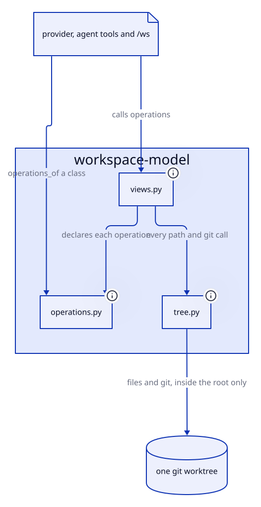

# Design: workspace-model

## Overview

`workspace-model` is what a workspace is, whoever provides it: the operations
a reader and an owner have over one git worktree. It is three modules on the
standard library alone: `tree.py` (`Tree`: one worktree's root, branch, base
and lock, its files and its git, and `resolve()`, the one door to a path),
`operations.py` (`@operation` and `operations_of`: an operation is a declared
method) and `views.py` (`WorkspaceView`, which reads, and `Workspace`, which
writes too). It makes no workspace itself: the provider builds the `Tree` and
hands out the view or the workspace, and every consumer (the agent tools,
`/ws`) learns the operations from `operations_of`.

## Decisions

- **An operation is a declared method, and extending is subclassing**
  (REQ-WSM-001). `@operation(description, writes=False)` on an `async def` of
  a `WorkspaceView` or `Workspace` subclass; `operations_of` is what every
  consumer reads, inherited operations first, so one a project adds reaches
  the agent tools without a line of theirs. A plain `def` is a `TypeError`
  where the class is defined, not at the first call. A method redefined
  without the decorator is no longer an operation. Why a base class here,
  when peers have none: what a subclass reuses is the behaviour itself.
  (baseline-workspace-model)
- **One writer, and the split is structural** (REQ-WSM-001, REQ-WSM-008).
  The owner gets a `Workspace`; anyone else a `WorkspaceView`, which has no
  `write`, `edit`, `delete` or `commit` to call. Alternative: one class with a
  permission check in each writing operation. (baseline-workspace-model)
- **A `Tree` is the one door to a path** (REQ-WSM-002). Every operation
  reaches files and git through it, and `Tree.resolve` refuses an absolute
  path, `..`, a symbolic link out of the worktree and git's own `.git`, before
  anything is read or written. Cost: a door by convention; an operation that
  calls `open()` itself can still leave. (baseline-workspace-model)
- **The files are the ones git tracks or would track** (REQ-WSM-005,
  REQ-WSM-007): `git ls-files --cached --others --exclude-standard`, so
  ignored files are out and new ones in. `glob` and `grep` both list through
  `Tree.files`. (baseline-workspace-model)
- **`grep` is Python's `re`, not `git grep`** (REQ-WSM-007). Why: `git grep`
  cannot match across a newline, and `rg` is a binary nothing guarantees. The
  search runs in a thread, stops at `limit` and says when it did, cuts a
  match's text at 500 characters and says so, and skips what is not UTF-8.
  (baseline-workspace-model)
- **A reader sees the work in progress** (REQ-WSM-004, REQ-WSM-006). `read`
  is the working tree as it is now, and `diff` is the working tree against
  the merge base, uncommitted and new files included, read through an index
  of its own in a temporary file. Alternative: `git add -N`, simpler, but it
  writes to the owner's staging area from a reader's call.
  (baseline-workspace-model)
- **A commit is everything changed, authored by the workspace's name, on its
  own branch** (REQ-WSM-009). Nothing to commit is a `ValueError`, never an
  empty commit, and the base is not touched: merging is no operation of
  either class. (baseline-workspace-model)
- **Writing operations run under the tree's lock, taken by the decorator**
  (REQ-WSM-010), so none has to remember to: writes run one at a time in call
  order, and reads never wait for each other. (baseline-workspace-model)

## Interfaces

- `operation(description, writes=False)`: the method decorator;
  `operations_of(cls_or_instance) -> List[Operation]`;
  `Operation(name, description, writes, parameters)`.
- `WorkspaceView(tree)`, with `name` (the owner's) and the reading
  operations: `ls(path=".") -> List[str]`,
  `read(path, offset=0, limit=2000) -> Lines`,
  `glob(pattern, path=".") -> List[str]`,
  `grep(pattern, path=".", glob=None, multiline=False, limit=100) -> Matches`,
  `diff() -> str`, `log() -> List[str]`.
- `Workspace(WorkspaceView)` adds the writing ones: `write(path, text)`,
  `edit(path, old, new, replace_all=False) -> int`, `delete(path)`,
  `commit(message) -> str`.
- Data shapes: `Lines(text, start, more)`; `Match(path, start, end, text)`;
  `Matches(matches, truncated=False)`.
- `Tree(root, owner, branch, base, view_class, identity=())`: `resolve(path)`,
  `relative(full)`, `git(*args, env=None, check=True, cwd=None)`,
  `files(path=".", glob=None)`, `read_bytes(path)`, `write_bytes(path, data)`,
  and `lock`.
- Errors: `ValueError` (a path refused, an invalid pattern, an edit whose text
  does not occur or is not unique, nothing to commit), `FileNotFoundError` (a
  missing file), `TypeError` (an operation that is not a coroutine),
  `GitError` (git failed).

## Constraints

- Standard library only, and no other part: `tests/test_architecture.py`
  enforces it. `git` is needed when an operation runs, never at import.
- Nothing blocks the loop: file reads, the search and git run in a thread or
  a subprocess.
- An operation reaches a path only through its `Tree`.
