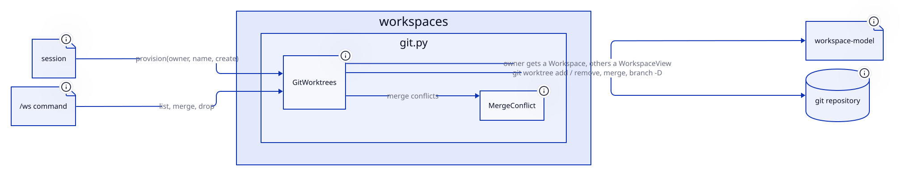

# Design: workspaces

## Overview

`workspaces` holds the workspace provider the library ships: `GitWorktrees`
(`git.py`), what `ChatSession(workspaces=…)` is given. It is not a peer: no
id, in nobody's roster, hearing nothing; it declares `HookProvision` and the
session routes every `workspace(name)` grant through its `provision`. Each
peer's workspace is a git worktree of one repository, at
`<repo>/.chatinho/worktrees/<name>` on branch `peer/<name>`, started from the
base. `/ws` uses it to list, merge and drop them.

## Decisions

- **The owner is a name, not an id** (REQ-WS-003, REQ-WS-004). Ids are
  numbered per session and the work has to outlive one, so a workspace is
  keyed by the peer's name and found again after a restart, also when only
  its branch survived. (baseline-workspaces)
- **One writer per workspace, by class** (REQ-WS-001, REQ-WS-003). The owner
  gets the `workspace` class, everyone else (a command included) the `view`
  class, which has no writing method to call. The pair is checked at
  construction: a workspace class that does not subclass the view would hide
  an operation added to the view from its owner, and a view with a writing
  operation would break the rule. (baseline-workspaces)
- **One `Tree` per workspace, so one lock** (REQ-WS-003). Owner and readers
  share the tree, and writes are serialized by its lock; an
  `asyncio.Lock` around opening makes two first asks create it once.
  (baseline-workspaces)
- **`create=False` makes nothing** (REQ-WS-003). It is how a peer asks who
  has a workspace without giving everyone a branch; a missing one is
  `KeyError`. (baseline-workspaces)
- **A worktree holds work, not cache** (REQ-WS-004). Closing the chat
  removes nothing; only `drop` does, worktree and branch together.
  (baseline-workspaces)
- **The repository stays clean** (REQ-WS-004). `.chatinho/` goes into
  `.git/info/exclude`, never a tracked `.gitignore`, so `git status` is
  empty without the provider editing the user's files; a committer identity
  missing from the config is passed with `-c`, not written.
  (baseline-workspaces)
- **A merge runs where the base is checked out** (REQ-WS-005), or in a
  temporary worktree removed afterwards when it is checked out nowhere. A
  conflict is aborted before `MergeConflict` is raised, so the base and the
  repository are as they were. (baseline-workspaces)

## Interfaces

- `GitWorktrees(repo, base=None, view=WorkspaceView, workspace=Workspace)`:
  raises `TypeError` for an invalid class pair, a view class that is no
  `WorkspaceView` included. `base=None` takes the branch checked out at start,
  or the commit on a detached HEAD.
- `async initialize()`: checks the repository and the base (`ValueError`, a path
  that is not a directory included),
  adds the exclude line; idempotent, and called on first use.
- `async provision(owner, name, create=True) -> WorkspaceView`: a `workspace`
  instance when `owner == name`, a `view` one otherwise. `ValueError` for a
  name outside `[A-Za-z0-9_][A-Za-z0-9_.-]*`, `KeyError` when missing and
  `create=False`.
- `async names() -> List[str]`, `async ahead(name) -> int`: the workspaces
  and how many commits each has that the base has not.
- `async merge(name) -> str`: what git said; `KeyError`, `MergeConflict`.
- `async drop(name)`: `KeyError` when there is no such workspace.
- `MergeConflict(RuntimeError)`: `.paths`, the conflicting files.
- Constants: `WORKTREES = .chatinho/worktrees`, `BRANCH_PREFIX = "peer/"`.

## Constraints

- A specialization: it imports the framework and `support/parts/workspace`,
  never another specialization (`tests/test_architecture.py`).
- Standard library only; `git` is needed when the provider starts, never at
  import.
- Nothing blocks the loop: every git call is awaited through `run_git`, and
  the exclude file is written in a thread.
